# Home grid: module cards on a cell grid

Epic [#61](https://github.com/xAlisher/basecamp-experiments/issues/61), issues #49 to #54. Branch `home-grid` in the Basecamp source, tested at commit `aa2e037`. Decision record: [ADR-080](adr/0080-home-cards-on-a-cell-grid.md).

## What and why

Home has two views. The feed (the default) lists everything, newest first. The modules view shows saved filters as cards: News, Transactions, Communities, Messages, Wallet and custom ones.

Before this work the module cards sat in 1 to 3 masonry columns. Height came from content. The only controls were a ⋮ menu with a size cycle and "Pin to the top". You could not put a card where you wanted it.

Now the cards sit on a cell grid. You arrange them in an edit mode: drag to move, drag an edge to resize, or use the keyboard. A card shows what fits in its block. The ⋮ menu is gone.

This changes only the module cards. App windows, the feed, the pills, Recent apps and the search bar are unchanged. The desktop Activity sidebar (feed only) has no grid.

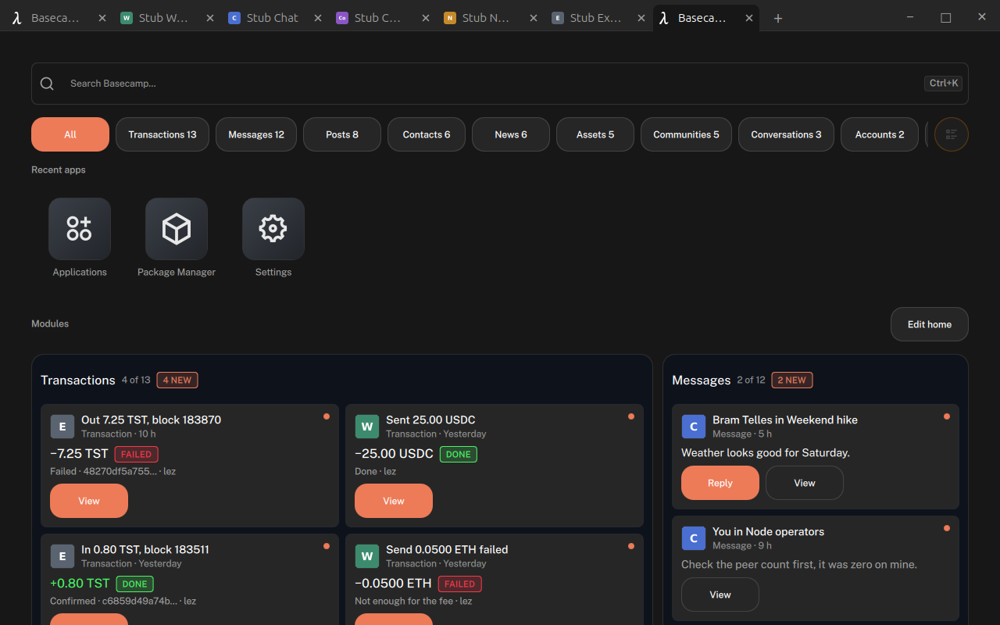

## The grid rules

- **Columns follow the content width:** under 600 px is 1 column, 600 to 999 is 2, 1000 to 1399 is 3, 1400 and up is 4 (`columnsFor`).
- **Rows are a fixed 120 px** (`kRowHeight`), with the theme's medium gap between cells. The page scrolls down as before.
- **A card is a block** `{ x, y, w, h }` in cells. Width is 1 to the column count. Height is 2 to 8 rows.
- **No overlaps, ever.** Moving or resizing a card pushes the cards it covers down, then everything moves up as far as it can (`place`, `resize`, `compact`). Shrinking a card pulls the next card up beside it.
- **Cards only move up, never sideways,** when space frees. A hole can stay to the left of a card (see "What is left").
- **A card with nothing to show** (the search or pill hides all its items) gives up its cells outside edit mode. In edit mode it keeps them.
- **The first layout comes from the old settings** (`migrateLayout`): pinned cards first; small, medium and large become 2, 3 and 4 rows; large is 2 wide; a strip is full width.

| Width | Columns | Default arrangement |
|---|---|---|
| 390 | 1 | All cards stacked, full width |
| 700 | 2 | Transactions 2x4 on top, Messages and Communities side by side, then Wallet, then News 2 wide |
| 1280 | 3 | Transactions 2x4, Messages and Communities stacked beside it, Wallet under, News 3 wide at the bottom |
| 1600 | 4 | Transactions 2x4, Messages, Communities, Wallet beside it, News 4 wide |

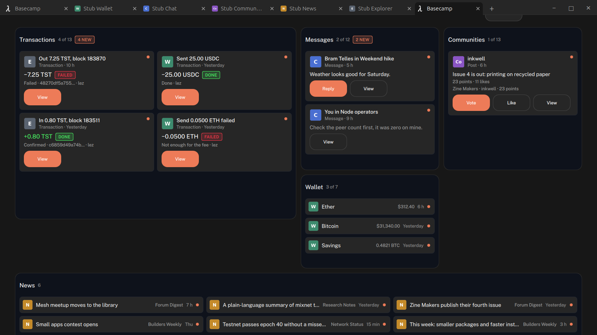 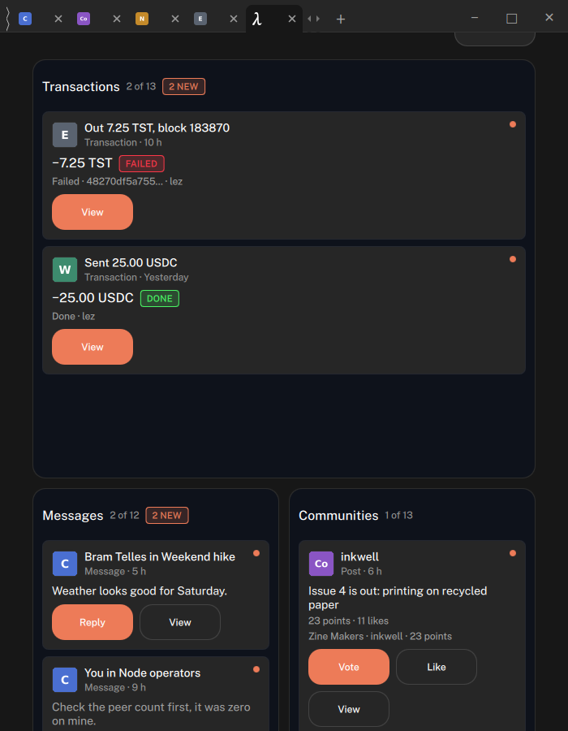 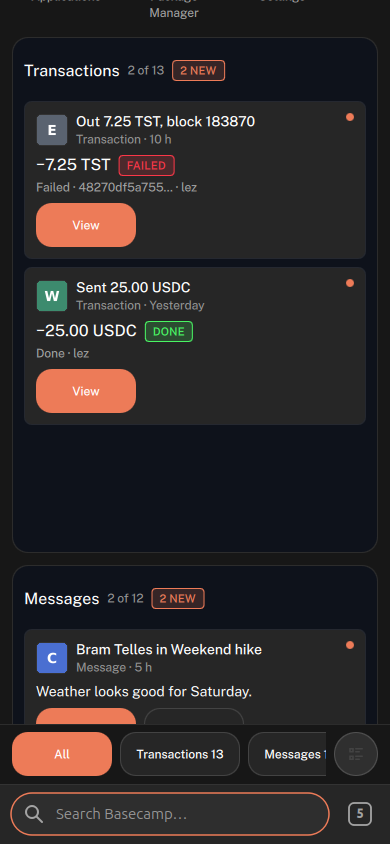

## Edit mode

Arranging only happens in edit mode, so a drag never fights scrolling or a card's buttons.

- **Enter:** "Edit home" beside the "Modules" heading (wide screens) or at the end of the grid, or a 500 ms press on a card's header. Both are in the modules view; the feed has no Edit home.
- **In edit mode:** every card shows, outlined, with a six-dot handle, a "Count new" switch and an ×. Card buttons (Reply, View, Vote) are dimmed and do nothing.
- **The bar at the bottom:** a hint, Undo (after a remove), Reset layout, Cancel and Done. The hint ends "Changes are kept when you press Done."
- **Drag to move:** press anywhere on the card and drag. It follows the pointer, a ghost marks the cell it lands on, and the others make room live. Near the top or bottom edge the page scrolls.
- **Resize:** handles on the right edge, the bottom edge and the corner. They snap to cells and stop at the limits. Each hit area is 44 px; the drawn bar is smaller.
- **Phone (1 column):** drag moves up and down only, and only by the header, so the rest of a card still scrolls the page. Only the bottom handle exists.
- **Done** saves the layout for this column count, the Count new switches and the removes. **Cancel**, Esc, switching to the feed and leaving home all put back what was there.
- **Reset layout** puts back the first layout for this column count. It is kept only with Done.
- **Remove** is the × on the card. The card goes, Undo brings it back where it was. Done makes it final.

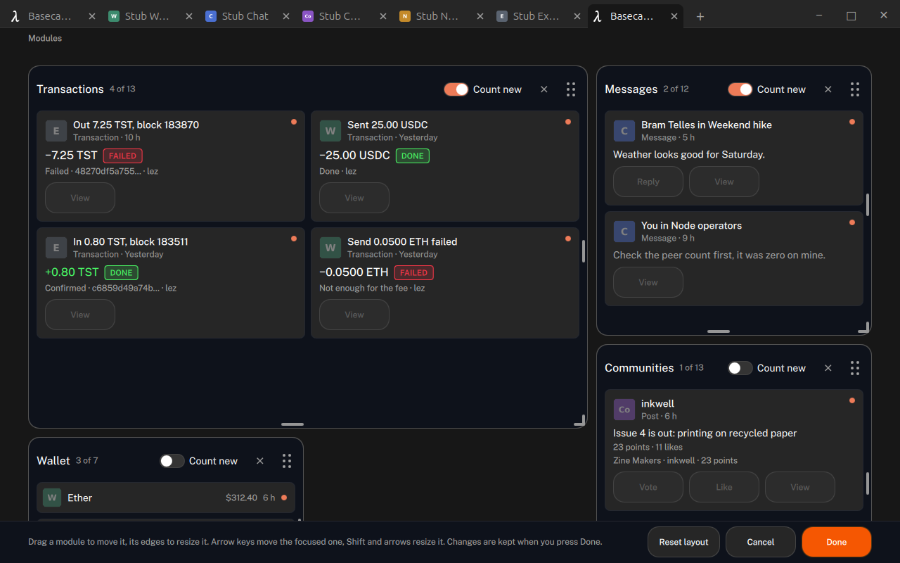
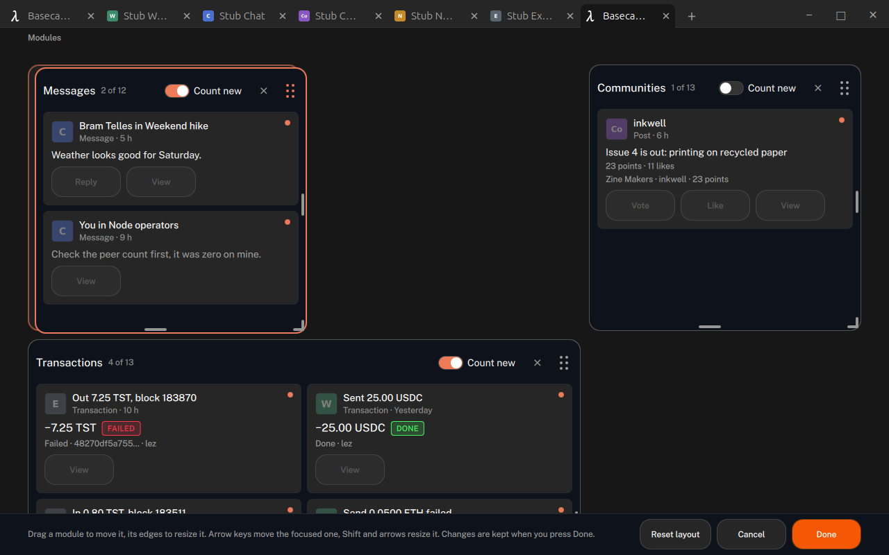
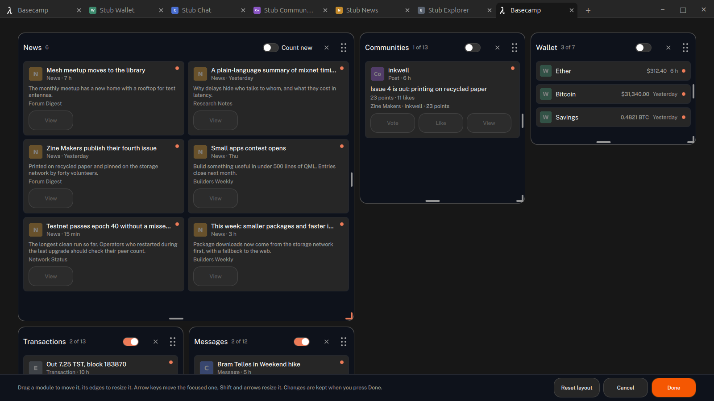
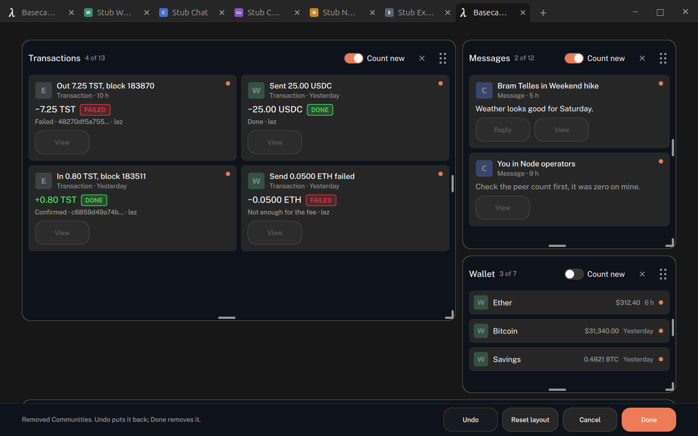

## Cards adapt to their size

- **Height decides how many items show.** The card builds its items, measures them, and shows only the ones that fit whole (`fitCount`). Nothing is cut mid-item.
- **2 rows tall is the compact form:** one-line rows (icon, title, time) instead of item cards.
- **Width decides inner columns:** 1 to 3, each at least 300 px (`itemColumns`).
- **The header counts what is shown:** "3 of 12", or just "12" when all show.
- **When not even one item fits,** the card shows one line such as "12 messages, 3 new". With the current sizes this does not happen in practice (a 2-row card always fits a compact row).
- **Only items on screen** are marked seen.

| Messages at 1600 | Form | Columns | Shown |
|---|---|---|---|
| 1x2 | compact rows | 1 | 3 of 12 |
| 1x4 | item cards | 1 | 3 of 12 |
| 2x4 | item cards | 2 | 6 of 12 |
| 3x6 | item cards | 3 | 12 |

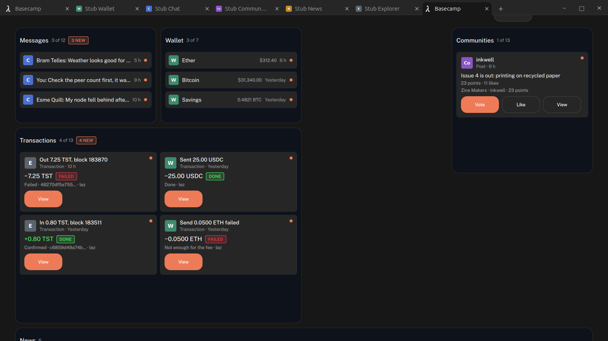 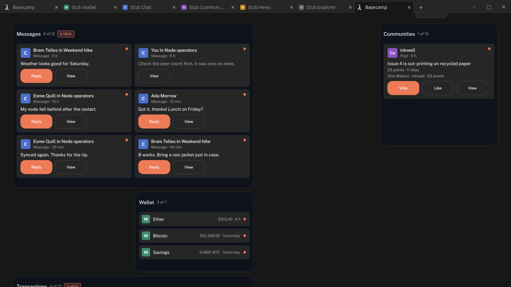 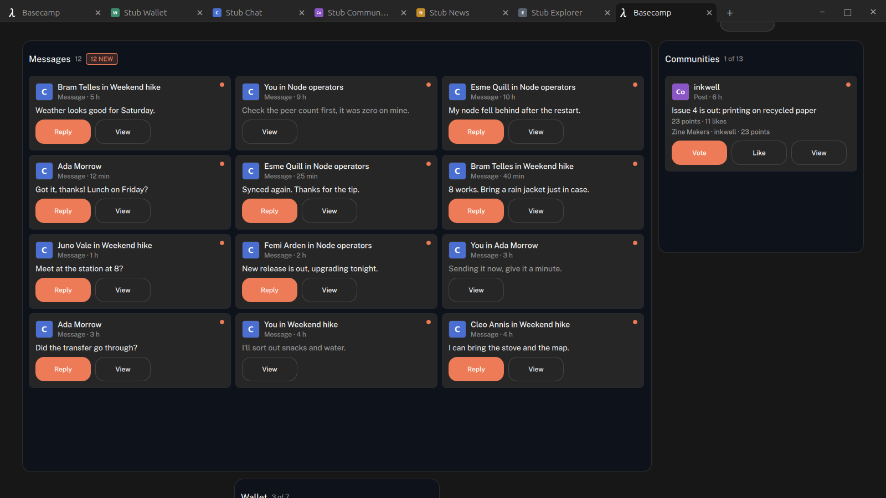
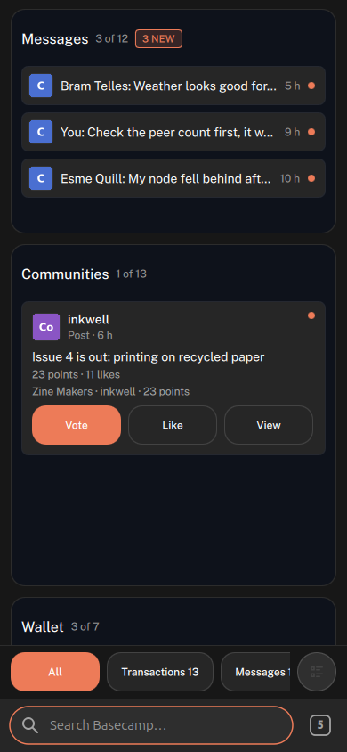 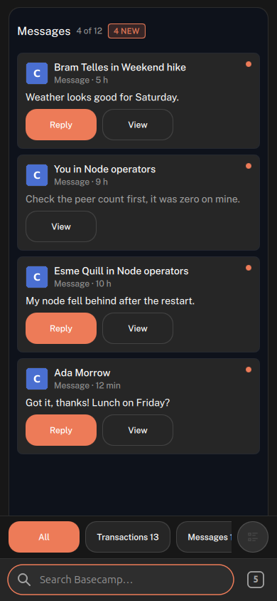

## Persistence

- Home's modules and layouts are saved by the shell in `<user dir>/home-settings.json` (`shell.saveHomeSettings`, `HomeSettingsStore`), under the home app's name.
- **One layout per column count.** A width with no saved layout borrows the widest saved one, keeps its reading order and clamps widths (`fitTo`). Nothing is saved by a window resize alone.
- **Resizing the window and back** gives the same arrangement.
- **Restarts keep it.** Home reads the settings once at start and never saves before that.
- Junk in the saved file is cleaned on read: unknown ids drop out, new modules get a 1x3 block at the end, sizes and positions are clamped (y at most 256 rows).

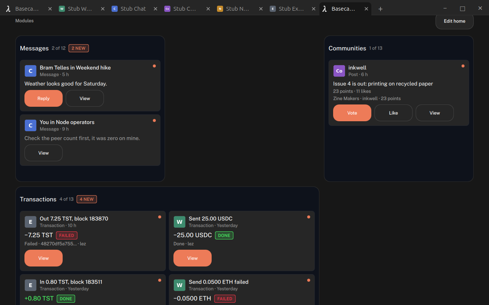

## Keyboard

- Tab reaches "Edit home"; Enter starts edit mode with the focus on Done.
- In edit mode, Tab goes through the cards in reading order (each card, then its Count new switch, then its ×), then Undo, Reset layout, Cancel and Done.
- On a focused card: the arrows move it a step, Shift and the arrows resize it a cell (Right and Down grow, Left and Up shrink). At the right edge, Shift+Right grows the card to the left.
- Enter is Done, Esc is Cancel. Outside edit mode the arrows and Esc work as in #47 and #48.
- Screen reader names: "Move News", "Resize News", "Remove News", "Count new in News".

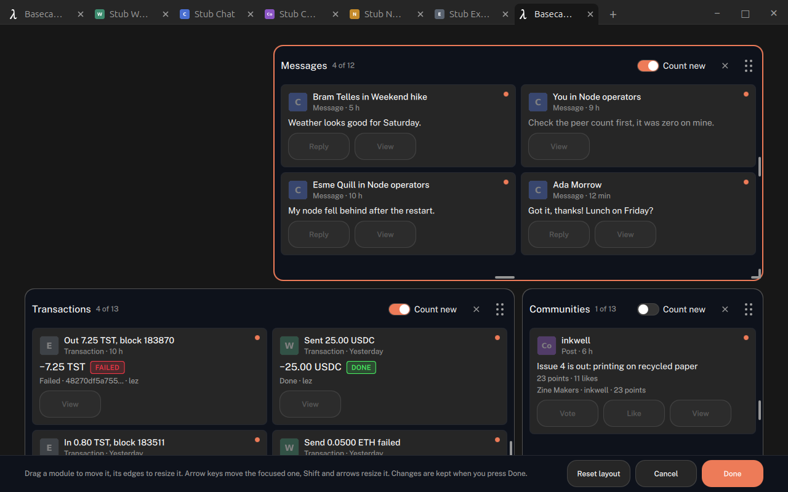

## Results (commit aa2e037, headless)

How things were driven: drags, clicks and long presses were real mouse events from a QtTest `TestCase` created in home's engine (`mousePress`, `mouseMove`, `mouseRelease` at coordinates in `home.scroll`). Keys were real `keyClick` events from a `TestCase` in the shell's engine (they go to the focused window). Where a step was only set up through a function (to reach a starting size), the table says "prep".

| Check | Result |
|---|---|
| Unit suite (44 tests, layout model, fitCount, settings store) | Pass, 44 of 44 |
| Default layout at 390, 700, 1280, 1600: no overlaps, no sideways overflow | Pass |
| 1600 to 700 to 390 to 1600 gives the same arrangement | Pass |
| Feed is the default view; pills and search still work | Pass |
| Hidden cards (search matches none) collapse outside edit mode | Pass |
| Edit home and a 500 ms header press start edit mode | Pass (false at 300 ms, true at 700 ms) |
| Card buttons inert in edit mode, live outside it | Pass (0 actions in edit, a View reached the app outside) |
| 1280: drag Messages to the top, Done, restart, kept | Pass |
| Cancel, Esc (1280) and leaving home restore the layout | Pass |
| 390: drag by header with auto-scroll; a drag on the body scrolls | Pass |
| Outside edit mode a press-and-drag on a card scrolls the page | Pass |
| 1280: Transactions 2 wide to 1 wide, Messages moves up beside it, kept after restart | Pass |
| 1600: News 1x3 (prep) to 2x5 by the corner, others move down, no overlaps | Pass |
| 390: News 3 (prep) to 6 by the bottom handle, no width handles; max 8 holds | Pass |
| Touch targets and overflow (`app-audit`) at 390 and 700, edit mode on | Pass, no findings |
| Cards adapt: counts, compact at h2, columns by width, nothing clipped | Pass (table above) |
| One-line summary when nothing fits | Not seen in the UI (unit test only) |
| Keyboard only at 1280: Edit home, move Messages, grow it, Enter saves | Pass (see note on step size) |
| No ⋮ menu; Count new and × work; Undo restores; Cancel drops both | Pass |
| Search highlight in module cards; Esc clears the search; arrows navigate | Pass |
| Applications page opens from Recent apps | Pass |
| Desktop overlay: grid and edit mode work; first Esc cancels edit, overlay stays | Pass |
| Activity sidebar: feed only, no grid, edit mode refused | Pass |
| QML errors in the run logs | None |
| 390 (Basecampium phone): Esc in edit mode | Failed at `aa2e037` (one Esc also went Back to the previous app, screenshot below). Fixed in `cd31c69`: the shell's Back asks home's `escapeEdit()` first. Unit-tested; not yet run headless |

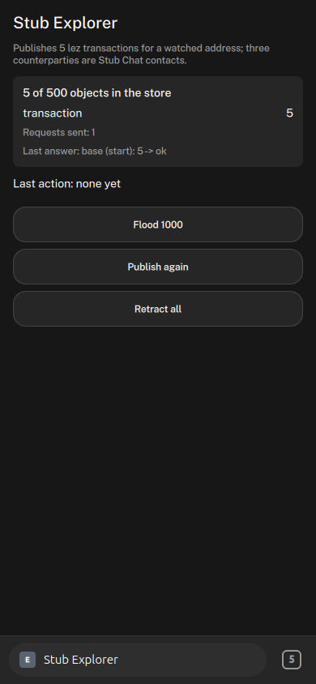

## What is left

Fixed after the test in `cd31c69`: Esc at phone width (above), and Done now drops the blocks of removed modules from the saved layouts (`pruneLayouts`).

- **Holes.** Cards only move up, so a hole can stay at the top left after a move or a grow to the left. A "fill gaps" step (move left too) would fix it but changes the reading order.
- **Arranging on a phone first** saves only the 1-column layout. Wider screens then derive from it and every card becomes 1 wide until arranged there.
- **Arrow keys move "a step",** which skips past a neighbour (Down from row 0 went to row 3, then 8), not exactly one cell.
- **Not checked by a person:** real touch on glass, resize cursors and hover colours, the move animation frame by frame, screen reader output, and Esc in the overlay on a real desktop.
