# Keychain: a directory of public keys and a router for signing requests

Epic [#62](https://github.com/xAlisher/basecamp-experiments/issues/62), issues #55 to #60. Branch `keychain` in the Basecamp source, tested at commit `eb1860b`. Test apps: [experiments/keychain-stubs](../experiments/keychain-stubs/README.md). Decision record: [ADR-081](adr/0081-keychain-routes-signing-holds-no-keys.md).

## What and why

Apps that hold keys (wallets, identity apps) and apps that need a signature (a login, a message, a transaction) had no shared way to meet. Each requester would have to know each signer, and the user had no single place to see which keys exist.

Keychain is that place. It is a list of **public** keys that signer apps add themselves, and a router: when an app asks for a signature, Keychain shows who is asking, the user picks a key, and the app that owns that key signs. **Keychain never holds a private key.** It checks every signature against the registered public key before the requester sees it.

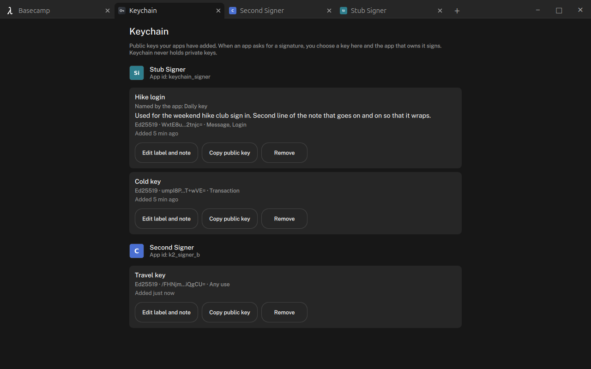

## The model

**A key entry** (in the shell host, `app/Keychain.*`):

| Field | Set by | Seen by |
|---|---|---|
| owner app id | the host (the caller it sees, plus the catalog source it was installed from) | Keychain app; the requester, only for the chosen key on `done` |
| owner display name | the host, from the app's manifest | Keychain app, result sheet |
| `keyId`, `name`, `publicKey`, `algorithm`, `purposes`, added time | the signer app | Keychain app, the owning app (`keys`); the requester gets `keyId`, `name` (as `keyName`) and `publicKey` of the chosen key only |
| `label` (up to 40 characters) | the user, in the Keychain app only | Keychain app, and the shell's own Signed sheet |
| `note` (up to 500 characters) | the user, in the Keychain app only | Keychain app only |

- `algorithm`: `ed25519` (32-byte key, verified). `secp256k1` is accepted and stored but never offered for signing yet.
- `purposes`: any of `message`, `transaction`, `login`. None means any.
- Limits: 32 keys per app, `keyId` 64 characters, `name` 64. A second `register` with the same `keyId` is `duplicate` (use `update`).
- Stored in `keychain.json` in the profile, rewritten whole through `QSaveFile`.
- Uninstalling an app removes its entries, label and note with them. Entries an app registered from another catalog source than it now comes from are dropped (a different package with the same name).

**Owner and requester are never self-declared.** Every `basecamp.keychain.*` intent is handled in C++ with the caller the intent broker attested. Nothing in the arguments names an owner, so an app can only touch its own keys.

**Shown names.** An app's display name is its own claim. Wherever Keychain names an app it also shows the app id the host attested ("Stub Requester (keychain_requester)"). A display name that is "Keychain", "Basecamp", a role holder's or another installed app's (compared on letters and digits, case folded) is replaced by the app id.

## API for signer apps

Declare in the manifest's `uses` what you call and in `provides` what the shell sends you. Undeclared intents are refused (`not_declared`).

```json
"uses": [
  { "intent": "basecamp.keychain.register" }, { "intent": "basecamp.keychain.update" },
  { "intent": "basecamp.keychain.remove" },   { "intent": "basecamp.keychain.keys" },
  { "intent": "basecamp.keychain.complete" }, { "intent": "basecamp.keychain.reject" }
],
"provides": [ { "intent": "keychain.sign" }, { "intent": "keychain.ended" } ]
```

Every answer comes back with `ok: true` and the real outcome in `data`, because the intent broker rewrites error codes it does not know to `failed`.

| Intent | Params | `data` |
|---|---|---|
| `basecamp.keychain.register` | `{ keyId, name, publicKey (base64), algorithm, purposes? }` | `{ ok, error? }`: `bad_request`, `bad_key`, `duplicate`, `too_many` |
| `basecamp.keychain.update` | `{ keyId, name?, purposes? }` | `{ ok, error? }` (`not_found`). Never touches the label or note. |
| `basecamp.keychain.remove` | `{ keyId }` | `{ ok, error? }` |
| `basecamp.keychain.keys` | `{}` | `{ keys: [{ keyId, name, publicKey, algorithm, purposes, added }] }`: own keys only, no label, no note |
| `basecamp.keychain.complete` | `{ requestId, signature (base64) }` | `{ ok, status }`: `done`, or `failed` when it does not verify |
| `basecamp.keychain.reject` | `{ requestId, reason? }` | `{ ok }` |

The shell sends, to the owner of the chosen key only:

- `keychain.sign` `{ requestId, keyId, payload, kind, purpose, requesterApp, requesterName, description }`. Answer `ok` as soon as the request is on screen, then show it **in your own words** (you are the only one who knows what the bytes mean), ask the user to approve, and call `complete` or `reject`.
- `keychain.ended` `{ requestId, status }` when the request ended while you had it, for a reason other than your own answer (requester closed, timeout).

Accept both only from requester `main_ui`. Only the app that owns `keyId` can complete or reject the request; any other app gets `{ ok: false }`.

```js
// On start: register, and on duplicate bring name and purposes up to date.
logos.request("basecamp.keychain.register",
              { keyId: "daily", name: "Daily key", publicKey: pk, algorithm: "ed25519",
                purposes: ["message", "login"] }, function (res) {
    if (res.data.error === "duplicate")
        logos.request("basecamp.keychain.update",
                      { keyId: "daily", name: "Daily key", purposes: ["message", "login"] }, function () {})
})

Connections {
    target: logos
    function onIntentRequested(id, intent, params, requesterName) {
        if (requesterName !== "main_ui") { logos.respond(id, false, {}, "failed"); return }
        if (intent === "keychain.sign") { showRequest(params); logos.respond(id, true, {}, "") }
        if (intent === "keychain.ended") { dropRequest(params.requestId); logos.respond(id, true, {}, "") }
    }
}
// After the user approves:
logos.request("basecamp.keychain.complete", { requestId: r.requestId, signature: sig }, function (res) {})
```

**Keeping private keys.** A signer keeps its own keys. QML LocalStorage is not safe for that: every `ui_qml` view runs in the host process, and Qt hands an open database connection to any engine that asks for the same name. The host offers `basecamp.appdata.read` `{}` and `basecamp.appdata.write` `{ data: {...} }`: one JSON object per app in `app_data/<app>/appdata.json` (mode 600), keyed by the attested caller, removed on uninstall. The Stub Signer uses it.

## API for requesting apps

```json
"uses": [ { "intent": "basecamp.keychain.sign" }, { "intent": "basecamp.keychain.cancel" } ]
```

```js
logos.request("basecamp.keychain.sign",
              { payload: Qt.btoa(challenge), kind: "login", description: "Sign in to Weekend hike" },
              function (res) {
    const d = res.data
    if (d.status === "done") check(d.signature, d.publicKey)   // and keep d.keyId
    else showNotSigned(d.status || d.error)
})
logos.request("basecamp.keychain.cancel", {}, function () {})  // the open one
```

- `payload`: base64, up to 32 KiB. `kind`: `message`, `transaction` or `login`. `description`: your own words, up to 120 characters, always shown as your claim. `purpose`, if given, must equal `kind`.
- The answer arrives **when the request ends**: `{ requestId, status, error? }`, and on `done` also `{ signature, publicKey, keyId, keyName, signerApp }`. `status` is `done`, `rejected`, `cancelled`, `timedOut` or `failed`. `keyName` is the signer's name for the key, never the user's label.
- Refused at once with `{ error }`: `bad_request`, `busy` (you already have one open, or you are held off), `unavailable` (nothing holds the keychain role), `not_in_front` (only the app the user is looking at may ask).
- **Held off:** for 10 seconds after a request you or the user cancelled or that timed out, and after 5 requests in a minute. This stops an app from pulling Keychain over what the user is doing.

## The flow

1. **Requester asks.** The shell brings the Keychain app forward with the request view: who is asking (tile, name, app id), their description in quotes marked "In the app's own words", the kind, and the keys that can sign it (matching algorithm and purpose; the user's label first, the note as a second line, the last key this requester used preselected).
2. **The user picks a key and presses Continue,** or Cancel. With no matching key, the view explains that and offers Cancel only.
3. **The signer opens** with `keychain.sign`, shows the request its own way and asks the user. Keychain shows "Waiting for <signer>" with an "Open <signer>" button.
4. **The signer completes or rejects.** Keychain checks the signature against the public key **as it was when the user chose it** (OpenSSL EVP Ed25519). A signature that does not verify ends the request as `failed` and is never passed on.
5. **Back to the requester.** The shell brings the requester forward and shows a sheet over it: **Signed** (signer app and key name, label first) or **Not signed: rejected / cancelled / timed out / failed** with the reason, dismissed with OK. The requester gets its answer.

| 390 | 1280 |
|---|---|
| 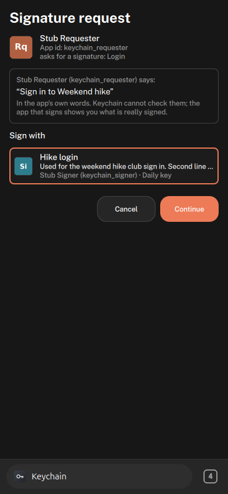 | 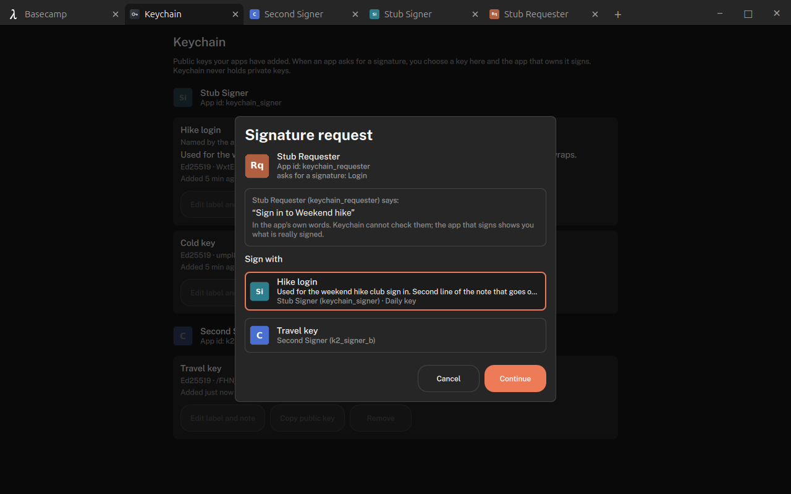 |
| 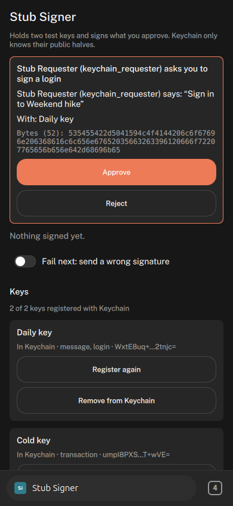 | 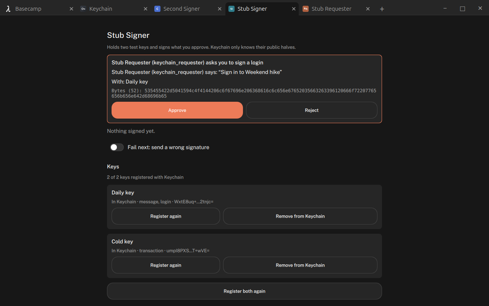 |
| 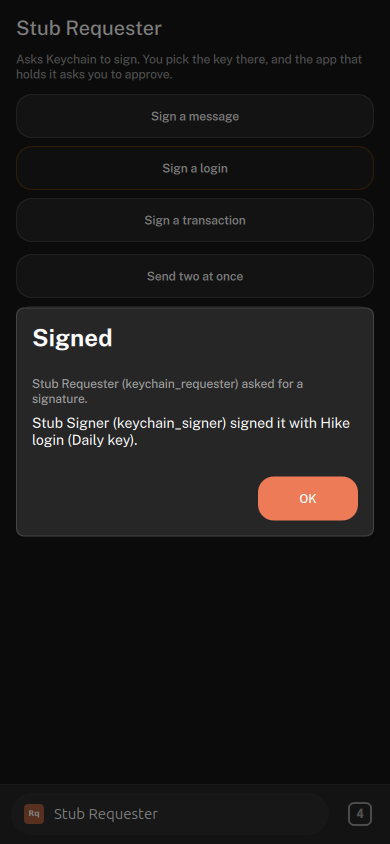 | 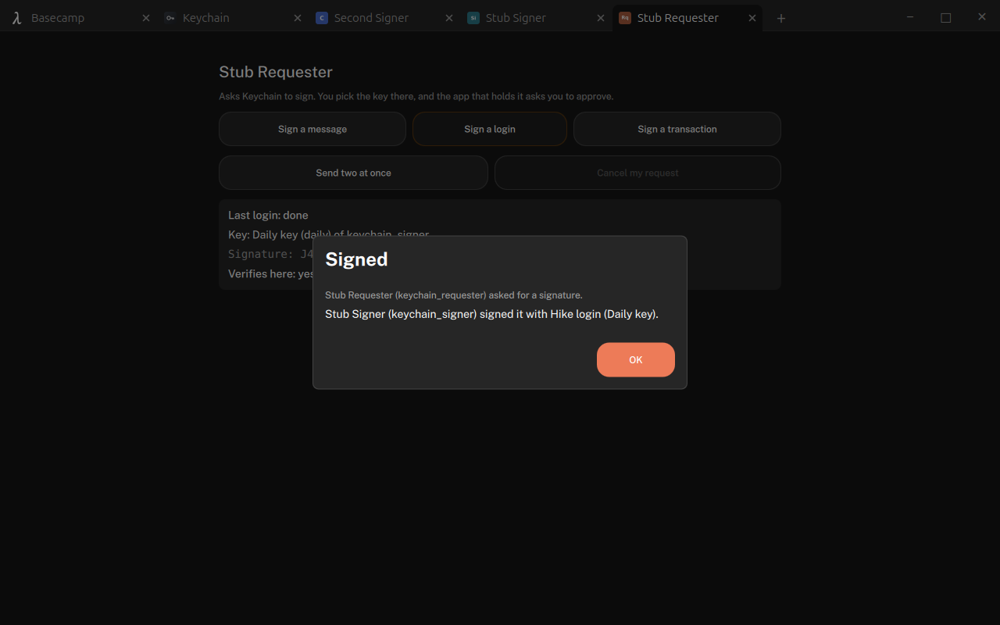 |

**States** (`app/KeychainBroker.*`, on the intent broker):

```
pending ──chooseKey──▶ keyChosen ──signer reached──▶ signing ──complete──▶ done
   └──────────────────────┴─────────────────────────────┴──▶ rejected   the signer said no
                                                             cancelled  Cancel in Keychain, Keychain closed, requester cancelled or closed
                                                             timedOut   5 minutes without a decision
                                                             failed     no signer, signer closed, bad signature, key removed or changed
```

| Ending | `status` | `error` | Sheet |
|---|---|---|---|
| Signer said no | `rejected` | `rejected` | Not signed: rejected, with the signer's reason in its own words |
| Cancel in Keychain | `cancelled` | `user_cancelled` | Not signed: cancelled, "You cancelled it in Keychain." |
| Keychain closed before a key was chosen | `cancelled` | `keychain_closed` | Not signed: cancelled |
| Requester cancelled | `cancelled` | `requester_cancelled` | none (the requester asked) |
| Requester closed | `cancelled` | `requester_closed` | none; the signer hears `keychain.ended` |
| Signer closed | `failed` | `signer_closed` | Not signed: failed, "was closed before it answered" |
| Signature does not verify | `failed` | `bad_signature` | Not signed: failed, "did not match its key, so it was not passed on" |
| Key removed under the request | `failed` | `key_removed` | Not signed: failed |
| Key replaced under the request (new public key) | `failed` | `key_changed` | Not signed: failed |
| 5 minutes | `timedOut` | | Not signed: timed out |

The 5 minutes run from when a request is the one on screen, so a request queued behind another app's gets its full time.

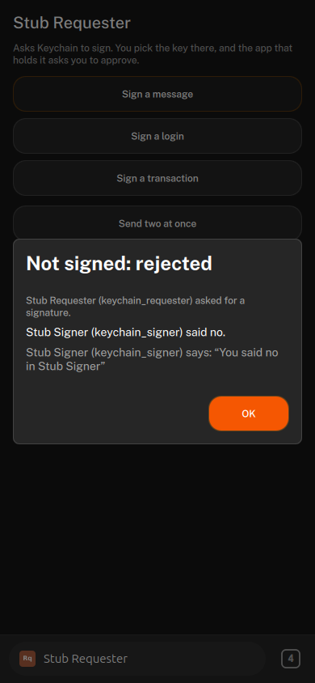 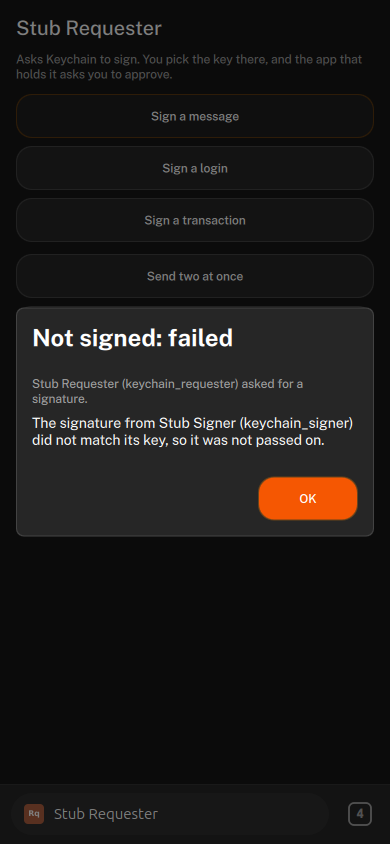 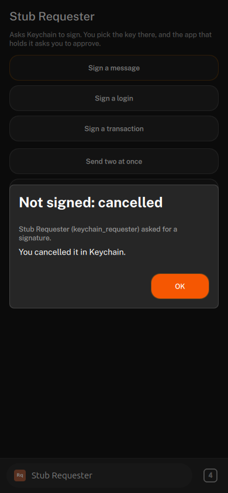 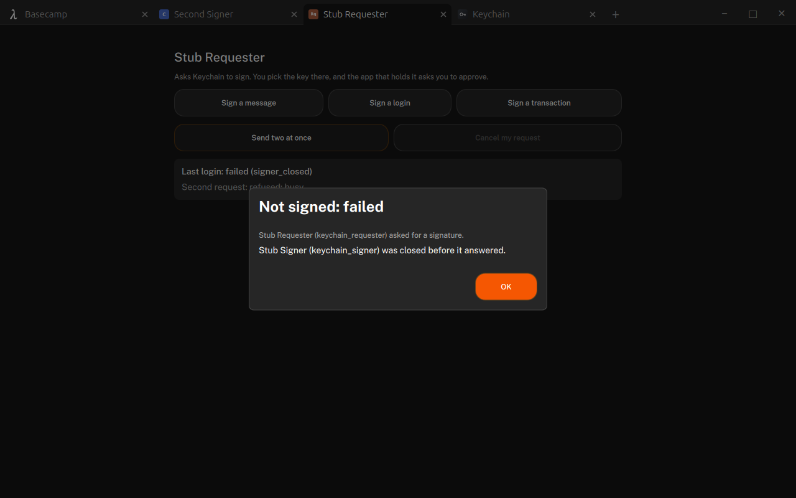

## The Keychain app and the role

`apps/basecamp_keychain` is a system app holding the new `keychain` role (Settings > Default apps). Another app that declares `"roles": ["keychain"]` can take the role; Basecamp's Keychain then shows "Another app is set as Keychain". The app reaches the host only through the role-gated `shell` object: `keychainKeys`, `keychainRequests`, `keychainRequest(id)`, `setKeyLabel`, `setKeyNote`, `removeKey`, `chooseKey`, `cancelSignatureRequest`, `openSigner`. Each call re-checks the role, so any other app (home included) gets empty lists and `false`.

- **Keys view:** grouped by owner app (tile, name, app id). Each key: the label as its name with "Named by the app: …" underneath, the note on one line until tapped, algorithm, first and last 6 characters of the public key, purposes, "Added …". Actions: Edit label and note (40 / 500 counters, Save / Cancel), Copy public key (toast), Remove (confirm; the signer keeps its private key and can add the key again).
- **Empty state** explains that apps add their keys themselves.
- **Layouts:** full screen at phone width; a centred sheet at wider widths; its own window in the desktop layout.

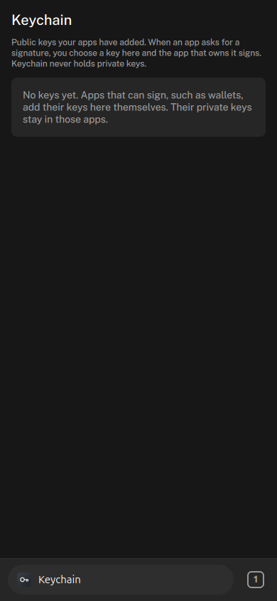 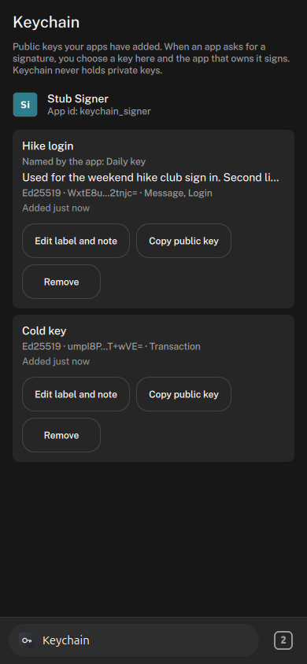 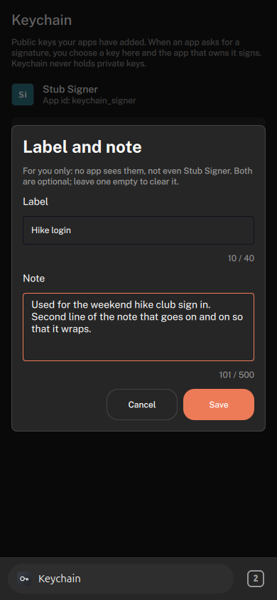 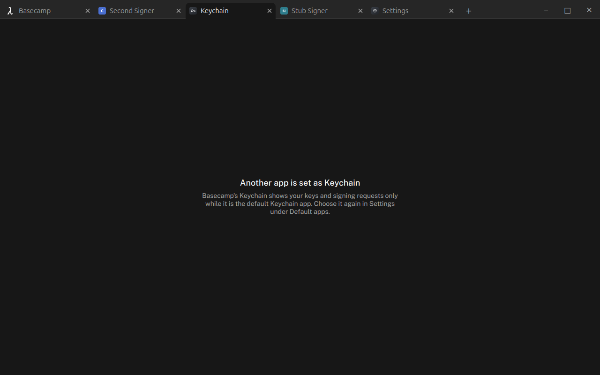

## Rules and how they are checked

| Rule | Unit test | Seen headless |
|---|---|---|
| An app cannot register, update or remove keys as another app | `anAppCannotTouchAnotherAppsKey`, `anotherSourceOfTheSameNameIsAnotherApp` | A second signer's `remove { keyId: "daily" }` got `not_found`; the Stub Signer's key stayed |
| A requester cannot list keys or learn about unchosen keys | `nothingAboutUnchosenKeysInAnyResult`, `aRequesterCannotReadAnotherRequest` | The requester's raw answer held only the chosen key's `keyId`, `keyName`, `publicKey`, `signature`, `signerApp`; an app without the intents got `not_declared` |
| Only the key's owner can complete a request | `onlyTheKeysOwnerCompletes` | A second signer's `complete` and `reject` on the Stub Signer's request got `{ ok: false }` ("answered a request it does not hold") |
| A wrong signature never reaches the requester | `badSignatureFailsAndIsNotPassedOn`, `malformedSignatureFails`, `aKeySwappedUnderTheRequestFails` | Fail next gave "Not signed: failed", no signature in the answer; log "does not verify, not passed on" |
| Payloads are not written to disk or logs | `payloadIsDroppedWhenTheRequestEnds` | Run logs and profiles grepped for the payload markers, their base64 and hex, the descriptions, label, note and the signer's seeds: no hits |
| Requests time out; a closed requester or signer ends the request | `timesOutAfterFiveMinutesInAnyOpenState`, `aQueuedRequestGetsItsFullFiveMinutes`, `requesterClosedCancelsAndTellsTheSigner`, `signerClosedFails` | Requester closed: signer showed "Request ended: cancelled". Signer closed: "Not signed: failed". Timeout: unit test only |
| The description is always shown as the requester's claim | `aBorrowedNameIsShownAsTheAppItself`, `aSignerWithAnotherSignersNameIsShownAsItself` | "Stub Requester (keychain_requester) says:" and "In the app's own words" |
| Label and note never reach another app | `labelAndNoteBelongToTheUser` | Not in the owner's `keys`, the signer's envelope or the requester's answer; home's `shell.keychainKeys` is empty |
| One open request per app | `busyWhileOneIsOpen`, `aCancelledRequesterIsHeldOff`, `atMostFiveAMinute` | Send two at once: the second got `busy`; a request right after a cancel got `busy` |
| A stub signature verifies with the host's OpenSSL | `keychain_stub_crypto_test` (RFC 8032 tests 1 and 2) | Both exported public keys checked a login and a transaction signature with `openssl pkeyutl -verify -rawin`; one flipped byte failed |

## Test apps

- **Stub Signer** (`keychain_signer`): makes "Daily key" (message, login) and "Cold key" (transaction) on first start with TweetNaCl-js 1.0.3 (vendored from the npm tarball through nix, sha256 in the stubs' README), keeps the seeds in `basecamp.appdata`, registers both. Sign screen with Approve / Reject, a "Fail next" switch, its keys with Register again and Remove from Keychain.
- **Stub Requester** (`keychain_requester`): Sign a message / a login / a transaction (fixed payloads starting `STUB-PAYLOAD`), Send two at once, Cancel my request, the last result and whether it verifies locally.
- Install: `experiments/keychain-stubs/sync.sh --install <profile>`. Open headless: `backend.loadUiModule("keychain_requester")`.

## What is left

- **keystore_module adapter.** `keystore_module` holds secp256k1 keys itself and has its own approval flow with `evm_signer_ui`. An adapter would list its accounts in Keychain as a signer and route a request to that flow. Needs secp256k1 verification in the broker. Not in this experiment.
- **secp256k1** keys are stored but never offered.
- **Uninstall** removing keys and app data is covered by unit tests only; sideloaded test apps cannot go through the package manager. The keep-keys-while-upgrading guard is not tested.
- **Catalog source** in the owner id was empty for sideloaded apps; for catalog installs it is unchecked.
- **The last-used key** is remembered in memory only, so after a restart nothing is preselected.
- **On wide screens** the request is a sheet over the Keychain app itself, not over the requesting app as #57 describes.
- **The Signed sheet shows the user's label.** It is the shell's own sheet, drawn over the requester; the requester's answer never carries it.
- **Not checked by a person:** real typing and Return in the label field, real touch, that Copy public key reaches the system clipboard (the toast shows; the headless clipboard read came back empty), GNOME focus when the signer or requester is brought forward.
- **The Stub Signer's keys** come from `Math.random` mixed through SHA-512 and are stored unencrypted. Test code only.
