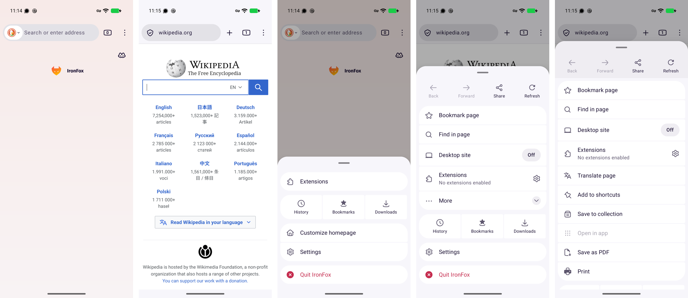
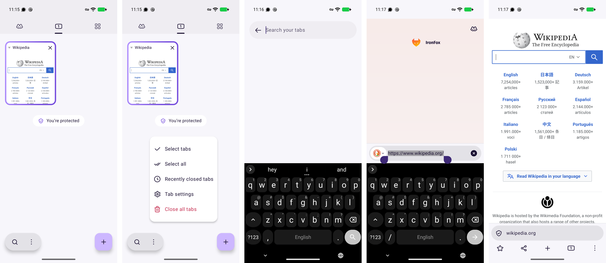
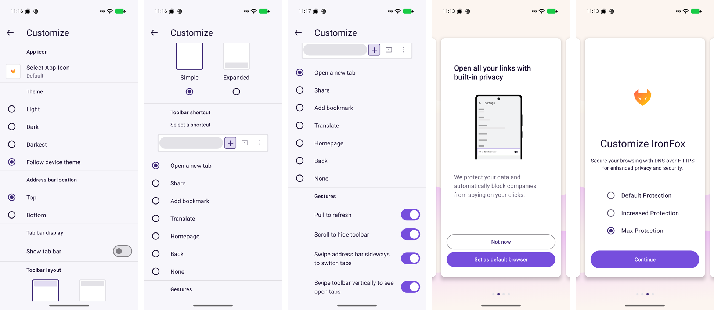

# Basecampium on a phone: what IronFox adds (spec, not built)

Status: proposal, 2026-10-22. Nothing here is implemented yet.
Source: IronFox 158.0.2 (hardened Firefox for Android, the maintained successor of Mull) on a
Pixel 10 / GrapheneOS. Builds on [MOBILE-ONE-BAR.md](MOBILE-ONE-BAR.md) (Mull 133, ADR-065).

## TL;DR

Twenty-five Firefox versions after Mull, the same browser moved its **menus into bottom sheets**,
its **tab list to a full page**, and its **toolbar into something you configure**. Four of those
changes fit Basecampium now:

1. **The ⋮ menu becomes a bottom sheet** of grouped rounded cards, 48 px rows, the shell apps as
   a row of three tiles, destructive actions in red. This also fixes the current menu, which
   renders as an unstyled light desktop menu with cramped rows.
2. **Menus fit their context:** items that don't apply are left out, not shown disabled. The
   exception is a fixed row that must not shift, like Back and Forward.
3. **Swipe up on the bar** opens the tab switcher.
4. **The switcher gets its own menu:** Recently closed, Close all (red), and later Search tabs.

## What changed since Mull (same browser, 133 → 158)

| | Mull 133 | IronFox 158 | Basecampium today |
|---|---|---|---|
| ⋮ menu | dropdown list under the button | **bottom sheet**: handle, grouped cards, a 3-tile row, red Quit | popup list from the bar (unstyled) |
| Page actions in the menu | icon row (back · forward · share · reload) on top | same row, **with labels**; Back / Forward greyed when unavailable | none |
| Long lists | everything at once | **"More" expands in place** (the sheet grows, then scrolls) | flat |
| Tab list | half-height sheet over the page | **full page**: segments, live thumbnails, floating search + ⋮ pill, + button | full page (validated) |
| Tab list menu | plain list | icons; **Close all tabs in red** with a trash icon | none (Close all is in ⋮) |
| Home | shortcuts, Jump back in, Recently visited, Collections | **logo only** on a soft gradient; tab count reads **0** | brand, search, apps, shell apps; count reads 0 (one bar) |
| Bar on a page | home · address · count · ⋮ | shield · address · **+** · count · ⋮ | pill · 🔔 · count · ⋮ |
| Bar position | top / bottom | top / bottom, **Simple / Expanded** (2 rows), a **configurable shortcut slot**, optional **tab strip** | bottom only |
| Gestures | pull to refresh, hide on scroll, swipe bar sideways | + **swipe the bar up for the tab list** | swipe the pill sideways |
| Editing | bar full width, mic + QR | bar full width; **QR → ✕ clear** once you type; at the bottom it **rides above the keyboard**, the action row hides | field in the pill |
| Settings | title + back | title + back + **🔍 in the title bar** | DS rule: search folds into the bar (same) |

## Proposals, in order

### P1. The ⋮ menu as a bottom sheet (fixes "menu is off")
- **Shape:** full width at phone size, rounded top corners, a drag handle, `backgroundSecondary`
  on a scrim. It slides up from the bar and closes on a tap outside, a swipe down, or Back.
- **Groups**, each a rounded card on the sheet:
  1. Tab actions: New tab · Reopen closed tab · Close tab. Rows are 48 px, with a 24 px icon and a label.
  2. **Shell apps as three tiles:** Applications · Settings · Package Manager (IronFox's
     History · Bookmarks · Downloads row).
  3. **Close all tabs**, alone, in `error` red with a trash icon.
- **On home** the sheet leaves out Close tab instead of greying it, as IronFox's home menu leaves
  out page actions.
- **Constraint:** app views are out-of-process windows and draw over anything in the shell's
  window. The sheet therefore has to be its own popup window, as the menu is today; a QML
  overlay inside the window would sit under the app. The scrim is the risky part: it needs a
  translucent popup the size of the window. Fallback: no scrim, sheet only.
- **Tokens:** DS colours (the current QMenu ignores the theme), rows ≥ 48, radius 16 on cards,
  20 on the sheet.

### P2. Context menus leave out what doesn't apply
Hide, don't disable, unless the item is in a fixed row (IronFox greys Back / Forward so the row
doesn't shift). Today's menu shows "Close tab" disabled on home: it should be absent.

### P3. Swipe up on the bar → tab switcher
IronFox: "Swipe toolbar vertically to see open tabs". This is the same gesture handling as the pill's sideways
swipe: vertical, ≥ 48 px, starting on the bar. Cheap. (On IronFox's home page the swipe did
nothing; on a page it is listed as on by default. Unconfirmed on a page.)

### P4. The switcher's own menu
A ⋮ in the switcher header with Recently closed and **Close all tabs (red)**. Add **Search tabs**
once there are more than about 8 tabs: a full-screen search with a back arrow, as IronFox does.

### P5. Later, not now
- **Toolbar shortcut slot** (IronFox lets you pick + / Share / Bookmark / Back / None for one bar
  slot, with a live preview of the bar). For Basecamp this could be a pinned app or New tab.
  Wait until people ask for it.
- **Bar position and an Expanded layout** (a second row of actions). One position until there's a reason.
- **Optional tab strip on phones.** IronFox offers it, off by default. Our desktop strip already
  exists, so this is cheap if wanted.
- **Keyboard:** a bottom bar must ride above the soft keyboard while editing. This only matters on a real
  Android build (Qt's `adjustResize`); check it then.
- **Live thumbnails** on switcher cards: blocked by out-of-process app views (MOBILE-LAYOUT.md Next §1).

## Patterns for the design system (not shell-specific)

- **Destructive menu items** in `error` with an icon (Close all tabs, Quit). DS menus have no
  destructive variant yet: add one to `LogosMenu` items.
- **State inline in a row:** "Desktop site · Off" as a pill on the right, "Extensions · No
  extensions enabled" as a subtitle. `LogosListRow` covers the subtitle; a trailing state chip
  would be new.
- **"More" that expands in place** instead of a submenu (submenus are hard to use on touch).
- **Empty state** (tab groups): an icon, a one-line pitch, how to start. Small "BETA" chip.
- **Labelled icon row** (Back · Forward · Share · Refresh): icons alone are ambiguous on touch.

## Onboarding (for a future Basecamp first run)

A carousel of cards: welcome, default browser (Not now / Set), then privacy choices one per
card. **Max Protection** is preselected, the DNS provider is revealed under it, and JIT and
Google Safe Browsing are each explained in one line. Uninstalled extras end with the system permission sheet
(uBlock Origin), which can be cancelled.
- Good: private defaults are preselected, there's one decision per screen, and each choice is explained in one sentence.
- Bad: the **progress dots stop at 4 of 4** while that step keeps adding screens (six more),
  so progress reads as finished when it isn't. If Basecamp gets a first run, the indicator must count real steps.

## Verified / not

Seen on the device (screenshots above): onboarding, home, both menus, More, the tab page, its menu, tab
search, editing, long-press on the count, Customize, the Expanded bottom layout. Swipe-up for the
tab list did nothing on home; not tried on a page. Settings were restored to Top / Simple;
Safe Browsing off, uBlock not installed, JIT off, language spoofing on (IronFox defaults kept
where they were the private choice).
