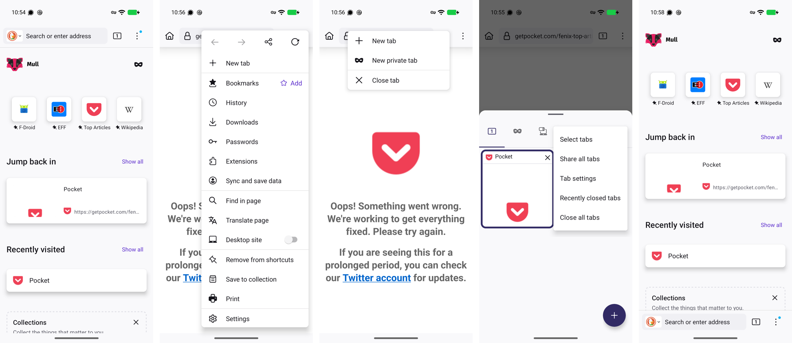
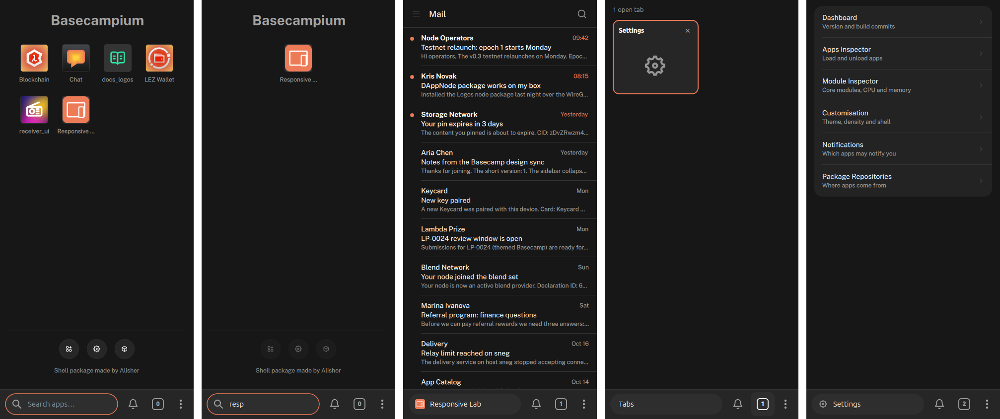

# Basecampium on a phone: one bar (after Mull)

Status: implemented on `mobile-layout`, 2026-10-22. Decision: [ADR-065](adr/0065-compact-one-bar.md).
Source: Mull 133.0.3 (Firefox for Android, DivestOS) explored on a Pixel 10 / GrapheneOS.
Supersedes the two-bar anatomy in [MOBILE-LAYOUT.md](MOBILE-LAYOUT.md#anatomy-below-600-px).

## TL;DR

- **One bar** at the bottom holds everything: `[ current tab · search ] [🔔] [tabs] [⋮]`. The
  top title bar is gone, so the app gets the whole screen above the bar.
- **New tab is the home page, not a tab.** It isn't counted, isn't listed in the switcher,
  and closes itself when you go to another tab. Opening an app from it turns it into that
  app's tab.
- On the home page the **pill is the search field**: typing filters the page, Enter opens
  the first result. On an app the pill shows its icon and title; tap = home, swipe sideways =
  previous / next tab.
- **⋮ menu:** New tab · Reopen closed tab · Close tab · Close all tabs · Applications ·
  Settings · Package Manager. **Long-press the tab count:** New tab · Close tab · Close all.
- **Esc / phone Back:** closes the switcher, or returns from home to the last tab.
- Above 600 px nothing changes.

## Mull's navigation, and what Basecampium takes

| Mull pattern | What it does | Basecampium (compact) |
|---|---|---|
| One toolbar: address · tab count · ⋮ | every control in one row; top or bottom (setting) | **Taken.** One bar, at the bottom (thumb reach, our earlier choice). |
| New tab = Home, not a tab | count stays the same; a tab appears only when you open something | **Taken.** New tab is transient; not counted or listed; closes when left. |
| Address bar is the search on Home | focused with the keyboard up as Home opens | **Taken.** The pill becomes the search field; the page's own search hides. |
| Address bar shows the page; tap → edit | the current tab's identity lives in the bar | **Taken.** Pill = current app's icon + title; tap → home. |
| Swipe the address bar sideways | previous / next tab | **Taken.** Swipe the pill (≥ 48 px, horizontal). |
| Long-press the tab count | New tab · New private tab · Close tab | **Taken**, without private tabs (Basecamp has none). |
| ⋮ menu, grouped by dividers | your things / page actions / app items; opens upward from a bottom bar | **Taken.** Tab actions, then the shell's own apps. |
| Tab tray: sheet, grid of cards, ✕ per card, + button, ⋮ (close all, recently closed) | | **Partly.** Our switcher is a page with cards and ✕; close-all and reopen live in ⋮. A sheet over the app isn't possible yet: app views are out-of-process windows that draw over siblings. |
| Back closes the sheet / menu; Back on Home → previous tab | | **Taken** (Esc and Key_Back). |
| A dot on ⋮ when an item inside has news | | Already ours: a dot on the tab count when another tab has unread notifications. |
| Address bar position setting (top / bottom) | | **Not taken** (one position until there's a reason). |
| Scroll hides the toolbar; pull to refresh | | **Not taken:** apps scroll inside their own views, which the shell can't observe. |
| Page menu row: back · forward · share · reload | | **Not taken:** apps have no shared history; a candidate once apps expose one. |

## Details

- Bar: 60 high; pill fills the row (44 high, rounded); bell, tab count and ⋮ are 48 × 48
  (⋮ 40 × 48). The bar's gaps still move the window on a desktop (it's a drag area).
- The pill on an app: icon 20 + title 15 px, `backgroundTertiary`; on home: magnifier + field,
  `primary` outline. In the switcher it reads "Tabs".
- The tab count counts app tabs only; with no apps open it shows 0 and the home page is shown.
- Menus are real popup windows (they sit over out-of-process app views); they open upward,
  right-aligned to their button.

## Verified

Headless (sway, 390 × 844, inspector-driven): home with the bar search; typing filters, Enter
opens the first app; the pill shows the app; tap → home with the count unchanged; menu actions
(through their signals); Back from home → the last tab, home gone; switcher lists app tabs only,
Back closes it; 700 px unchanged (tab strip). 0 QML errors.

**Not verifiable headlessly:** the menus' look (the headless compositor doesn't map a popup
without a real input event; Qt reports them shown), the swipe and the long-press (no real touch),
and the soft keyboard. Please try those on a touchscreen.
