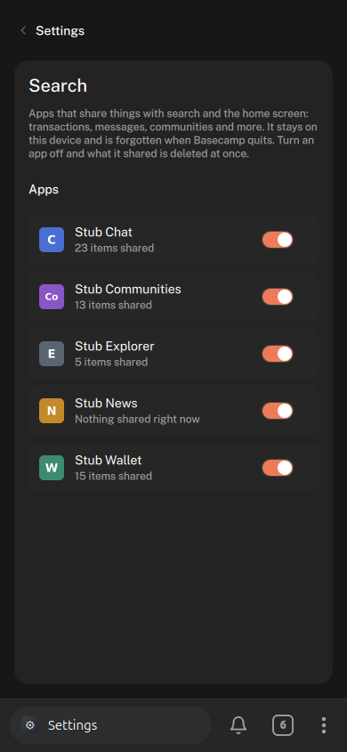
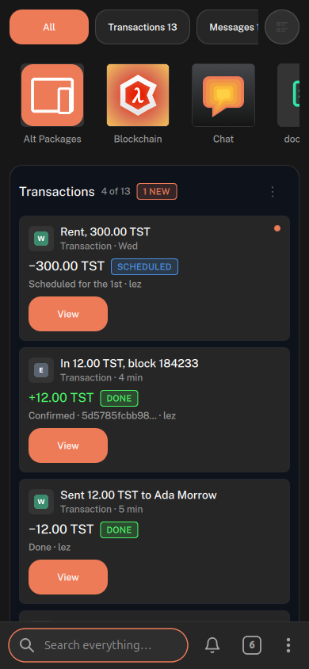
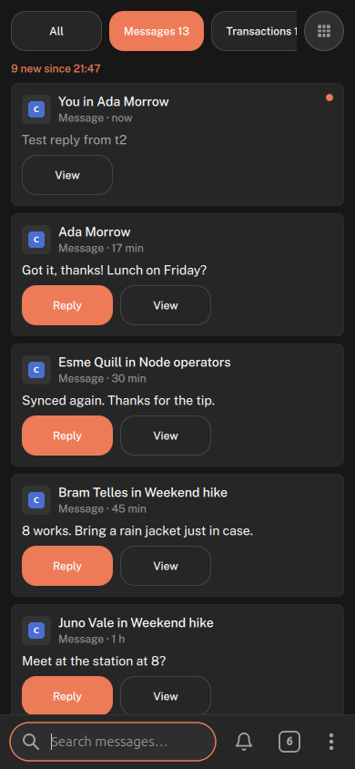
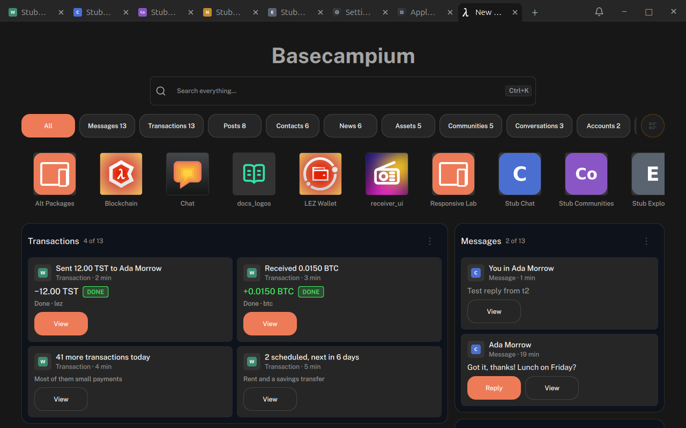
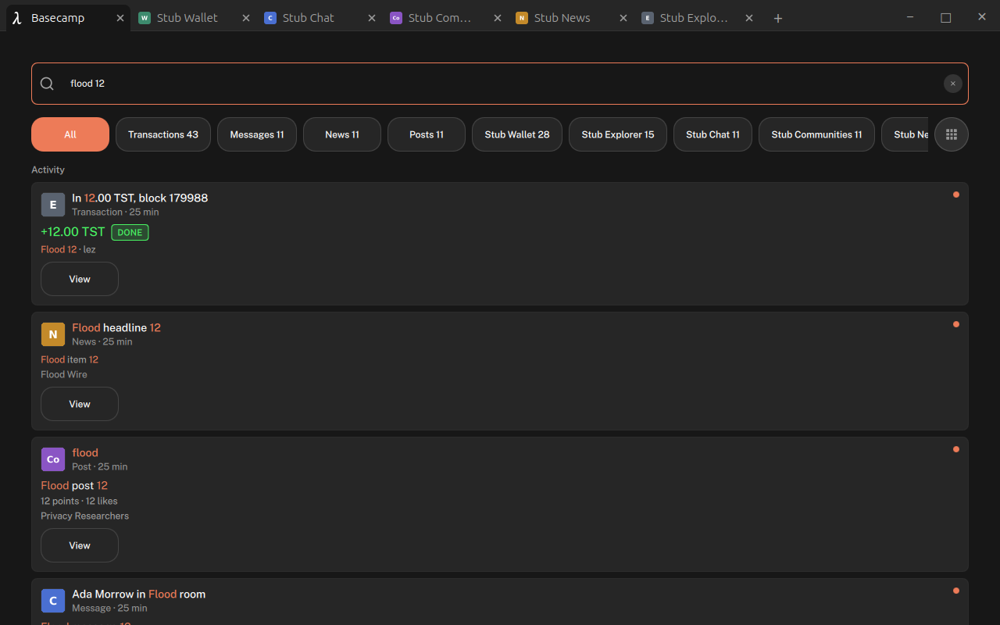
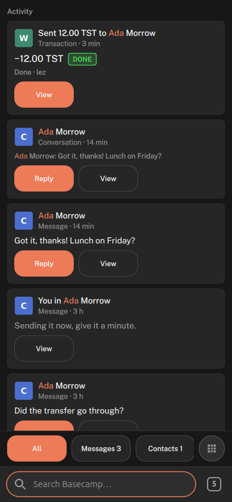
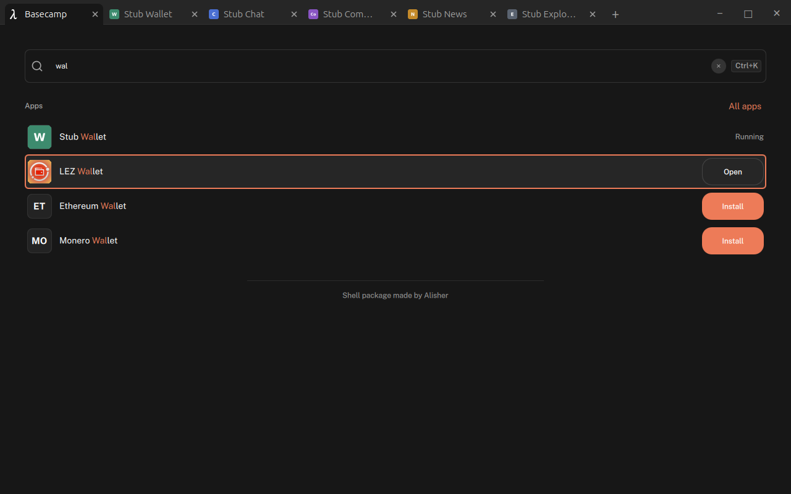
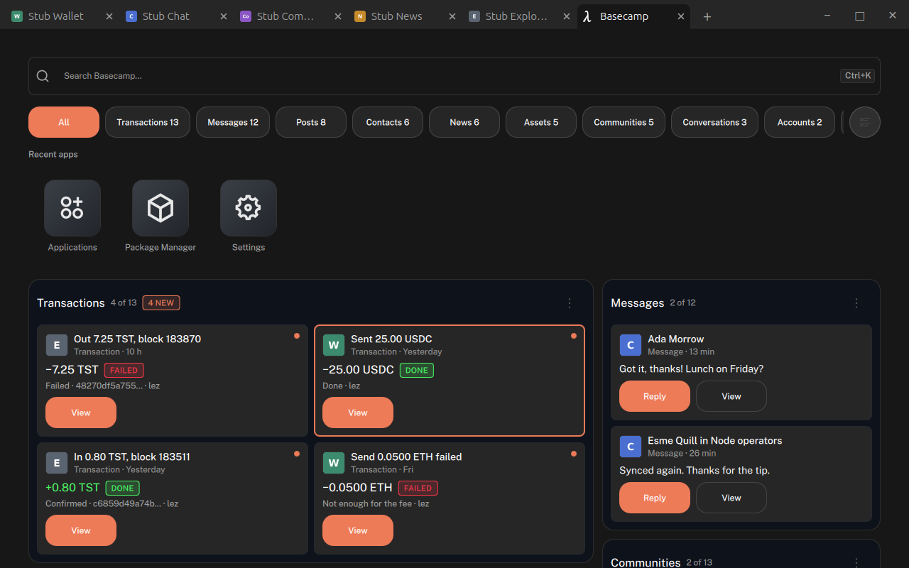

# Shell objects: apps publish, search ranks, views draw

Status: draft, 2026-10-24. Steps 1 to 4 built (§11, §12); step 5 (experiments) not yet. Decision: [ADR-072](adr/0072-apps-publish-typed-objects.md).
Grows out of [SHELL-ROLES-SPEC.md](SHELL-ROLES-SPEC.md) Part B and generalises
[NOTIFICATIONS-SPEC.md](NOTIFICATIONS-SPEC.md).

## TL;DR

- **Apps publish objects to the shell:** a transaction, a message, a community, a contact, a
  balance. Each object has a **type** from a shared list, so a wallet and a block explorer both
  publish `transaction` and the user sees one Transactions card, not two apps.
- **Three jobs, three owners:**
  - the **host keeps the objects** (the store) and enforces who may read and write;
  - the **`search` role ranks** them for a query and a filter, and draws nothing;
  - **views draw** them (home, Applications, the tab switcher), one look per type, whichever app
    the object came from.
- Objects **update in place** (a transfer's progress, a balance), **carry actions** (Join, View,
  vote, reply) that go back to the app that published them, and **refer to each other** (a
  transaction's counterparty is a contact) by a shared subject, never by display name.
- The **bar's text is the query** in every view; filters are pills; a home **module is a saved
  filter** with a size.
- Nothing is collected unless an app publishes it; Settings → Search has a switch per app, and
  switching off **deletes** what that app published. **Whether objects may carry private content
  (message text, amounts) is open** (§9); the experiment carries it, in memory only, on the device.

## 1. Why

Each app keeps its world to itself, so the shell can't answer "what happened", "where is that
thing" or "do the next step" across apps. Notifications (ADR-042, ADR-043) were the first object
apps could hand to the shell; they are one type among several. The roles work (ADR-067 to ADR-071)
gave the shell a way to let a user-chosen app do a system job; search and home are those jobs here.

## 2. Who does what

| Part | Who | Does | Never |
|---|---|---|---|
| Publisher | any app declaring `basecamp.objects.publish` | publishes, updates and retracts its own objects; answers actions on them | reads other apps' objects |
| Store | the host (`ObjectStore`, next to `NotificationCenter`) | keeps objects per app, applies limits, switches and retraction, routes actions | ranks or draws |
| Search | the `search` role holder | takes a query + filter, returns ranked object ids | draws, or acts on objects |
| Views | `home`, `launcher`, the shell's switcher | ask for results, draw them by type, raise actions | read objects outside a result |

With no `search` holder, the host's own fallback ranker answers (title and keyword match, newest
first), so search never breaks because a role app did.

## 3. The object

One envelope for every type. Fields marked *host* are set by the host and can't be supplied.

| Field | Type | Rules |
|---|---|---|
| `id` | string | *host.* Stable for `app` + `key`. |
| `app` | string | *host*, from the intent requester. |
| `key` | string | Required, max 128. The app's own id for this thing. Same `app` + `key` **replaces** (the notification `tag` rule, generalised). |
| `type` | string | Required. From the type list (§4), or `x.<app>.<name>` for an app's own type (drawn with the generic card). |
| `kind` | `item` \| `summary` \| `action` \| `setting` | Default `item`. `summary` stands for many ("41 more transactions today", "2 scheduled"); `action` is something to do ("Send", "New chat"); `setting` is a place in the app's settings. |
| `title` | string | Required, plain text, max 80. What the generic card and a one-line row show. |
| `subtitle` | string | Optional, max 120. |
| `fields` | object | The type's fields (§4). Unknown fields are dropped with a diagnostic. |
| `keywords` | string[] | Optional, max 16 × 32. Extra words to match; not shown. |
| `subjects` | string[] | Optional, max 8. Who or what this is about (§6). |
| `refs` | `[{ type, key, app? }]` | Optional, max 8. Other objects this one points at. |
| `actions` | `[{ id, label, input? }]` | Optional, max 3. `input: "text"` asks the view for a line of text (reply). The first action is primary. Clicking the object itself is always `open`. |
| `progress` | 0..100 | Optional. Drawn as a bar; `100` reads as done. |
| `time` | ms since epoch | Optional; defaults to publish time. What the feed sorts by. |
| `updated` | ms | *host.* |
| `seen` | bool | *host.* False until a view shows it; "N new since …" counts unseen. |
| `expires` | ms | Optional. The host drops the object after it. |
| `icon` | url | *host*: the publisher's local icon (ADR-071). Per-object pictures (avatars, coin logos) are not in v0 (§9). |

Plain text only, as for notifications: no markup, links or images from apps.

## 4. Types (v0)

Fields are the minimum each card needs. Every field is marked **label** (says what the thing is)
or **content** (says something personal: amounts, text, who you deal with). The marks are what
the open privacy decision (§9) will act on; v0 carries both.

| Type | Fields (label) | Fields (content) | Typical actions |
|---|---|---|---|
| `account` | `name`, `network` | `balance` `{ amount, unit, fiat? }` | open |
| `asset` | `name`, `symbol`, `account` (ref) | `amount`, `fiat`, `change` (%) | open |
| `transaction` | `direction` (`in` \| `out`), `status` (`pending` \| `sending` \| `receiving` \| `done` \| `failed` \| `scheduled`), `network` | `amount`, `unit`, `counterparty` (subject), `address` | View |
| `message` | `conversation` (ref or name), `outgoing` (bool) | `sender` (subject), `senderName`, `text` | Reply (`input: "text"`) |
| `post` | `community` (ref) | `author` (subject), `authorName`, `text`, `score`, `likes` | Vote, Like |
| `community` | `name`, `members`, `joined` (bool) | | Join / Leave |
| `contact` | `name`, `groups` (`family`, …) | `subject` | View, Message |
| `news` | `source`, `url` (not opened by the shell) | `text` | open |
| `notification` | `level` | `body` | as today (ADR-042) |

Reserved, no fields yet: `profile`, `nft`. Published by the host itself: `app` (installed apps,
for search only), `tab` (open and recently closed tabs).

**Counts across types** ("Ada: 3 transactions") are not fields: a view asks the search role for
objects whose `subjects` include the contact's subject and counts them.

## 5. API

### Publishing (any app)

Declared in `metadata.json` like notifications:

```json
"uses": [{ "intent": "basecamp.objects.publish" }]
```

```qml
logos.request("basecamp.objects.publish", { objects: [
    { key: "tx:0x91…", type: "transaction", title: "Sending to Ada", progress: 20,
      fields: { direction: "out", status: "sending", amount: "0.3319", unit: "BTC",
                counterparty: "logos:pk:…" },
      subjects: ["logos:pk:…"], actions: [{ id: "view", label: qsTr("View") }] }
] }, res => {})
logos.request("basecamp.objects.retract", { keys: ["tx:0x91…"] }, res => {})   // or { all: true }
```

- Answers as for notifications: `ok`, `not_declared`, `bad_request` (with the first bad object's
  index), `failed` (limit). **A switched-off app still gets `ok`.**
- Batches are all-or-nothing.
- **Actions come back** as `objects.action` to the publisher: `{ key, action, text? }` (`text`
  only for `input: "text"` actions, at most 1000 characters). The app declares it in `"provides"`.
  It can't be `basecamp.objects.action`: the registry refuses apps that provide a `basecamp.*`
  intent. Two rules keep it shell-only:
  - the shell sends it with a **targeted submit** (`IntentBroker::submitTo`) to the publisher of
    `key` alone, with no chooser, even when several apps provide `objects.action`;
  - **only the shell may request it** (`restrictIntentToRequesters`); an app that declares it in
    `"uses"` gets `unavailable`. Publishers should still accept it only from requester `main_ui`.
  `open` is always delivered and the app is brought to front first. An action the object doesn't
  list, or an unknown id, is refused before anything is sent.

### Search role

The `shell` object (ADR-069) gains, for the `search` holder only:

- `searchRequested(requestId, query, filter)`: a view wants results. `filter` is
  `{ types?, apps?, kinds?, subjects?, unseenOnly? }`.
- `objects(filter)`: the objects the filter allows, as a list of envelopes.
- `objectsSince(version, filter)`: what changed since `version` (0 for everything):
  `{ version, reset, objects, removed, ids? }`, so the holder can keep its own copy instead of
  copying the whole store on every query. `reset` says to drop the copy and take `objects` as all
  of it. `ids` (only when the filter narrows) lists the ids the filter allows. Same objects as
  `objects()`, nothing more (§14, ADR-082).
- `answer(requestId, ids)`: ranked ids, at most 200. Unknown ids are dropped.
- `objectsChanged(app)`: something was published or retracted; a search may re-rank.

### Views

For `home` and `launcher` holders (and the shell's own switcher):

- `search(query, filter)`: returns a live results model of envelopes in rank order; it refills when
  the search role answers again.
- `raise(id, action, text?)`: send an action to the object's publisher.
- `markSeen(ids)`.
- `counts(query)`: how many objects match, per type and per app, with no cap (for pills).
  Read on request, never pushed.
- Home only: `setBarPlaceholder(text)`, what the shell's bar reads ("Search transactions…");
  plain text, one line, at most 60 characters; `""` gives the shell's own back.

Views get only the objects in their results, not the whole store. A results model holds at most
200 ids; when more match, the view says "Showing N of M".

## 6. Subjects: how objects refer to people and things

A contact in a chat app and the counterparty of a transfer in a wallet must match without either
app knowing the other. Objects say who they are about with **subjects**: opaque strings with a
scheme, compared exactly.

- `logos:pk:<hex>`: a Logos public key (chat identity, node identity).
- `<network>:<address>`: a chain address (`lez:…`, `btc:…`).
- `x.<app>:<id>`: anything app-local (matches only within that app).

Names never join objects: two "Ada"s stay two people. **Open:** a contact usually has a key
while a transfer has an address; something has to say "this address belongs to this contact"
(§9).

## 7. Views and the bar

- **The bar is the search field** in every view; its placeholder names the active filter
  ("Search transactions"). Typing narrows the current view; the view never loses the field to a
  title.
- **Filters are pills**: one per type that has objects, plus per-app; the row scrolls. A pill can
  be pinned.
- **A home module is a saved filter**: `{ name, filter, size (small | medium | large | row),
  pinned, notify }`. "Add custom module" saves the current query and pills. Order, size, pin and
  notify belong to the home app (its own settings), never to the objects.
- **Feed** is all objects by `time`; "N new since 14:48" counts unseen objects since the user last
  looked.
- **Cards are drawn by type** from `fields`, with a generic card (icon, title, subtitle, time,
  actions) for anything else. The card set lives with the shell's shared QML (like the app tile),
  so a replacement home can reuse it or draw its own.

## 8. Settings, limits, revocation

- **Settings → Search:** one row per app that declares `basecamp.objects.publish`, with a switch,
  as for notifications. **Off removes everything that app published at once**; while off, new
  publishes are dropped (still answering `ok`). Uninstalling an app removes its objects.
- Limits per app:
  - 500 objects: past that the oldest by `time` are evicted and the publish still answers `ok`;
    a single batch of more than 500 answers `failed`;
  - 20 publish requests per 10 s (the 21st answers `failed`; retract is not limited);
  - `fields` at most 2 KB per object (`failed`);
  - `time`, `expires` and `progress` must be finite numbers, times at most 8.64e15 ms
    (`bad_request`).
- One intent payload is capped at 1000 nodes by the bridge, so about 50 objects fit in a request;
  a 1000-object flood takes about 20 requests and meets the rate limit.
- **Switching an app back on tells it nothing:** its objects stay missing until it publishes
  again. Apps should republish what is current on start and when it changes; whether the shell
  should send an "enabled again" signal is open (§9).
- Settings rows are announced at most once a second and only when a row changes, so other apps
  can't time each other's publishes from it.
- **v0 keeps everything in memory** and loses it on restart; apps republish what is current when
  they start. Nothing is written to disk and nothing leaves the device.
- Only the `search` holder reads across apps; views read only their results; publishers read
  nothing.

## 9. Open questions

- **Privacy: content or pointer.** Do objects carry personal content (message text, amounts,
  counterparties), or only labels, with content fetched from the app when shown?
  - *Content in the object* (v0): fast, works with the app closed, but the shell and the search
    app hold a copy of everyone's private data.
  - *Pointer:* the object has labels; the view asks the app for the content when drawing. Nothing
    personal leaves the app, but search can't match on content and a closed app shows blanks.
  - *Per field:* label fields pushed, content fields pulled; the field marks in §4 make this
    possible without changing the types.
  - Whatever is chosen, it is decided before anything ships outside this experiment, and Settings
    must say plainly what each app shares.
- **Subjects and ownership:** who says an address belongs to a contact (the wallet, the contact app,
  the user)?
- **Persistence:** in memory is honest for v0; a feed that survives restarts needs storage, and
  then encryption and deletion become part of the switch.
- **Pictures:** avatars and coin logos need a way to publish small images without remote URLs
  (ADR-071).
- **Ranking signals:** recency, frequency of opening, unseen, pinned pills; which belong to the
  search role and which to the view.
- **Switching back on:** should the shell tell an app it was switched on again, so it
  republishes, or is "republish on start and on change" enough?
- **Type list ownership:** who adds a type; how an app type (`x.<app>.<name>`) graduates.
- **Layouts:** home and modules are Basecampium-only today (ADR-070); the sidebar and desktop
  layouts need their own views.
- **Abuse:** notifications have a list of forbidden uses (re-engagement, urgency); objects need the
  same before third-party publishers.

## 10. Plan

1. **Store and intents (host).** `ObjectStore`, `basecamp.objects.publish/retract`, `objects.action`,
   limits, Settings → Search with switches; notifications become a type internally, their intent
   stays (not done yet).
   Unit-tested; verified with a test app.
2. **Stub publishers** (`experiments/objects-stubs/`), backends stubbed, each with a "flood" button
   (1000 objects):
   - Wallet: accounts, assets, transactions with moving progress, summaries;
   - Chat: messages, contacts, reply;
   - Communities: communities, posts, Join, votes;
   - News: news items;
   - Explorer: a second source of `transaction`, sharing subjects with Chat's contacts.
3. **`basecamp_search`**, the default `search` role app: ranks by match, recency and unseen.
4. **Views:** home modules, pills and feed in `basecamp_home`; the per-type cards; the bar as query
   everywhere in Basecampium.
5. **Experiments:** grid vs. feed densities; "N new since"; a module per saved filter; replacing the
   search app; flood performance at 390 and 1280; the same data with content vs. pointer.

## 11. Steps 1 and 2: built

Issues #22, #23, #24. Host code in `basecamp/app/` (`ObjectStore`, `IntentBroker::submitTo`,
`ShellIntents`, `MainUIBackend::raiseObjectAction`, `ShellApi`) and
`basecamp/apps/basecamp_settings/qml/SearchView.qml`; stubs in `experiments/objects-stubs/`.

- **Unit tests:** 32 of 32 pass, among them `object_store_test` (validation, upsert keeps `seen`,
  retract, eviction, rate window, 2 KB cap, switch, expiry, retain on uninstall) and the targeted
  submit and shell-only requester tests.
- **Headless, the five stubs on one shell:** 60 objects across 9 types with exact counts per app;
  pending transfers move 20 → 60 % in place; flood stops at 500; retract all empties one app only;
  Join flips a community and Vote raises a score; Reply with text adds an outgoing message; actions
  never reach another app, even one publishing the same `key`; an app declaring `objects.action`
  in `"uses"` is refused; `open` brings the publisher to the front; Settings → Search off deletes
  at once and switching on again restores nothing until the app republishes.
- **Not tested end to end:** uninstall deleting objects (unit-tested through `retainApps` only).
- **Found on the way:** two `ui_qml` apps that ship a QML file with the same name collide; the
  second app loads the first one's file and the sandbox blocks it ("Type StubApp unavailable"). The
  stubs use per-app file names.



## 12. Steps 3 and 4: built

Issues #25, #26. Host: `ObjectSearch`, `ObjectRanker`, `ObjectResults` in `basecamp/app/`; the
default search app `basecamp/apps/basecamp_search/`; shared cards `basecamp/src/Basecamp/Objects/`
(one per type plus a generic one); home in `basecamp/apps/basecamp_home/`.

- **Ranking** (the same rules in C++ and in basecamp_search's JS, checked by a unit test over 11
  queries): every query word must start a word in the object; title 4, keywords 3, subtitle 2,
  field text 1; score = 10 × match + up to 5 for recency (halves each day) + 3 if unseen; an empty
  query lists unseen first, then newest. Matching on field content is one constant
  (`kMatchContentFields`), so the privacy decision (§9) can turn it off.
- **The search holder runs in the background**, without a tab. The host ranks when nobody holds
  `search` (Settings → Default apps → Search → None) or the holder takes more than 500 ms.
- **Home**: the bar is the query and names what it searches; pills per type and per app with
  uncapped counts; modules (saved filters: small, medium, large, row; pin; count new; at most 7)
  kept in memory only; a feed with "N new since"; Join, Vote, Reply with text and View from
  cards. A card never shows two buttons with the same label: the built-in View is dropped when
  the app offers its own. Cards are plain text (a title with markup shows the tags).
- **Unit tests:** 34 of 34. **Headless** (fresh profile, five stubs, 390 and 1280): all 16 checks
  pass, among them "ada" ranks Ada's items first, None gives the same order from the host, no
  duplicate button labels across all 60 objects, the placeholder per pill, Join and Reply reaching
  the stub, live progress, switch-off removing cards at once.
- **Review fixes** (7): home freed its results models so module edits could evict the feed's;
  pills were capped at 200; publisher markup rendered in cards; views could time other apps'
  publishing; two background-load races; no test tied the JS ranker to the C++ one.
- **Open, small:** pills reorder by count under the finger; your own reply counts as new; the
  Wallet module sits alone in a grid row at 1280; typing into a card's Reply field needs a check
  on a real device (headless keystrokes went to the bar); Home and Launcher have no row in
  Settings → Default apps.

| 390 grid | 390 feed, Messages | 1280 |
|---|---|---|
|  |  |  |

## 13. Flood and keyboard: results

Issues #27 (flood part), #46, #47, #48. Measured on the Basecampium home with the five stubs
open, each one's Flood button pressed at the same time (the store keeps 5 x 500 = 2500). "Before"
is the build before the flood fixes (8507ef8), "after" is f3640bc. All runs are headless
(llvmpipe, software rendering), so absolute times are high; compare the columns, not the numbers
with a real GPU.

| What | 390 | 1280 | How measured |
|---|---|---|---|
| Publishes land (5 floods) | 32 to 203 ms | 32 to 220 ms | A recorder on `objectStore.changed`, time when each app reached its cap |
| Results refreshed after the flood | 303 ms (before: 708) | 322 ms (before: 597) | A recorder on home's `allResults.resultsChanged` |
| One query, text set to results shown | 183 to 337 ms (before: 253 to 515) | 191 to 266 ms (before: 260 to 558) | Home's field text set (1280) or `backend.setHomeQuery` (390); time to home's `rawQueryChanged` handler, so it includes the 100 ms wait after the last keystroke |
| Longest UI stall per query | 96 to 216 ms (before: 250 to 515) | 109 to 208 ms (before: 260 to 558) | A 16 ms timer in home's engine; the stall is how late it fired |
| Searches for one burst of 5 keystrokes | 1 | 1 (before: 6 per keystroke) | Count of "answered by" lines in the log |
| UI stalls in the 60 s (390) or 200 s (1280) after the flood | none over 50 ms (before: about 0.4 s every 2.1 s for about 3 min) | none over 50 ms (before: the same) | The same 16 ms timer |
| Feed order while idle after the flood | stays | stays (before: the top changed every 2.2 s) | No results change while idle; screenshots |
| Host memory after the flood | 534 MB (446 MB before it) | 504 MB | PSS from `/proc/<pid>/smaps_rollup`; stubs and role apps run in the host |
| Host CPU, idle after the flood | 3.6 % | 4.5 % | utime + stime over 10 s |
| Baseline, 60 objects, one query | 87 to 364 ms, most about 105 | 101 to 267 ms, most about 105 | The same method; mostly the 100 ms wait |

**What holds.** Counts, eviction and the rate limit were right before and still are. The
mark-seen loop is gone: home now marks only what it showed, and marking no longer ranks again.
Typing asks for one search per pause, not one per letter and per module.

**What does not.** Each search over 2500 objects still blocks the UI for 100 to 200 ms (one run
at 390 showed up to 440 ms, while the test window had lost its size, so it is left out). The
ranking runs on the UI thread. (Addressed in §14: 50 to 70 ms median now.) After a flood, about 2400 objects stay unseen until they are
scrolled into view; that is by design (only what was shown is marked), but the "N new" counts
stay high.

**Highlight (#46), as built.** The start of each word that a query word matches shows in the
accent orange: card titles and subtitles, message, post, news and notification text, and app
names in the Apps block. It uses the ranking's rule (case-insensitive, start of a word), so "12"
in "12.00" is marked. Publisher text is escaped first, so a title with `<b>`, `&amp;` or
`` shows the characters, never markup (unit tests). Recent apps are not marked,
because that row is hidden while there is a query.

**Esc (#47), as built.** Basecampium at 600 px and wider: Esc in home's field empties it, the pill
stays, and a second Esc does nothing. Below 600 px, Esc and Back go back to the last tab, as
before. Desktop overlay and Activity sidebar: Esc with text clears it, Esc with an empty field
closes the surface. Esc from the dock or the top bar closes at once (unit test only).

**Keys (#48), as built.** Down from the field moves into the results: Recent apps (Left and Right
along the row), then the Apps block's rows, then the cards. In the modules view the arrows follow
the screen: Left and Right along a module's row or columns, Up and Down to the line above or
below. Up from the first row below Recent apps goes back to the tile you left. Enter does what a
click does: Open, bring a running app forward, Install, or a card's first action. Typing on a
result goes back to the field and adds the letter. Esc on a result goes back to the field and
keeps the text. The focused result has a 2 px accent ring. Not on the phone layout, where the
search is the shell's bar.

How the keys were driven: QtTest `keyClick` from a test object in the host's engine. It sends to
the focused top-level window, so the shell's key filter and the focused widget see the key as
they would a real one. It is still not a physical keyboard.

**Open, small.** A focused Recent apps tile moves its label up about 4 px. Enter on an Install
row and on a card whose first action is a text field were not run headless. Screen reader output
needs a person with Orca.

| 1280, "flood 12" after the flood | 390, "ada" | 1280, keys on an app row | 1280, keys in a module |
|---|---|---|---|
|  |  |  |  |

## 14. Broad-query latency: results

Issue #27, the last open item of §13: a broad query ("a") over a full store blocked the UI for
longer than a 100 ms budget. Decision: [ADR-082](adr/0082-search-role-keeps-a-copy.md). Basecamp
source: branch `keychain`, commits 146732b to 37fe093.

**Method.** As §13: the five stubs open, each one's Flood pressed at once (the store keeps
5 x 500 = 2500), home on screen in a New tab, headless (llvmpipe). A 16 ms timer in home's engine
gives the longest stall (how late it fired); "results" is the time from setting the text (home's
field at 1280, the shell's bar at 390) to the first idle turn after home's results changed for
that text, so it includes the 100 ms wait after the last keystroke. Five runs per query, the field
emptied between queries; the burst is five keystrokes 40 ms apart. Before (ce1b1f4) and after
(37fe093) ran side by side in the same session; this machine was busier than in §13, so compare
the columns, not the numbers with §13's.

| Query (matches) | Longest stall, 1280 | Longest stall, 390 | Results, 1280 | Results, 390 |
|---|---|---|---|---|
| "a" (356, 200 shown) | 266 / 335 → **61 / 93** | 291 / 294 → **62 / 70** | 350 / 436 → 176 / 203 | 364 / 368 → 173 / 181 |
| "ada" (86) | 234 / 312 → **57 / 69** | 279 / 294 → **51 / 55** | 336 / 394 → 169 / 178 | 343 / 369 → 163 / 165 |
| "12" (83) | 298 / 304 → **59 / 80** | 293 / 338 → **60 / 64** | 366 / 416 → 172 / 189 | 368 / 403 → 175 / 180 |
| "tx" (0) | 140 / 162 → **36 / 53** | 154 / 175 → **42 / 48** | 242 / 249 → 139 / 142 | 235 / 240 → 140 / 142 |
| Burst "f" to "flood" (2440) | 203 / 260 → **65 / 69** | 210 / 223 → **52 / 71** | 311 / 365 → 173 / 175 | 324 / 330 → 172 / 182 |
| Emptying the field (2500) | 193 / 239 → **68 / 101** | 189 / 256 → **59 / 75** | 200 / 238 → 69 / 98 | 195 / 262 → 67 / 79 |

Median / max in ms, before → after. Searches per query or burst: 1, before and after.

| Also measured | Before | After |
|---|---|---|
| One query in home's engine, "a": search / pill counts / feed | 67-71 / 12-15 / 72-82 ms, and the counts and the feed twice | 4-10 / 1-4 / 16-25 ms, once |
| Stalls while the five floods land (one run from a fresh start) | 10 over 40 ms, up to 202 ms, one per refresh for 12 s | 5 over 40 ms, up to 86 ms |
| The same, flood again after Retract all (2 runs each) | 115 to 156 ms | 49 to 90 ms |
| Host memory after the flood (PSS) | 518 MB | 547 MB (the kept copies; this run also had the Keychain open) |

**What changed.**
- *The search role keeps a copy.* The store numbers every change (publish, replace, retract,
  evict, expire, switch off, mark seen). `basecamp_search` asks `objectsSince(the version it
  holds)` and gets only what changed; a query no longer copies 2500 envelopes into its engine.
- *Words are split once.* Each object's title, keywords, subtitle and field text become one string
  of lowercased words, so "a word starts with the token" is one substring search. The split happens
  a few hundred objects at a time while idle, or before a query that needs it; an empty bar needs
  none. The host keeps the same index for `counts()` (the pills) and its fallback ranker.
- *Home asks once.* Each query rebuilt home's results twice (once from the answer, once more
  straight after asking): the pill counts and all 30 feed cards, twice. Now once. The widgets had
  the same double rebuild.
- *The feed keeps its cards.* A card whose object stays keeps its item, a card that moved is moved,
  and only new ones are made, at most 6 per pass, a frame apart.

**Unchanged.** Results and their order: unit tests compare the prepared ranking with the
envelope ranking (C++ and JS), and the kept copy with ranking the store's current objects through
a flood, eviction, retraction, replacement, marking seen, expiry and the switch. In the running
build, the search app's answers equalled the host ranker's for 8 queries x 4 filters, and for
five queries the result sets equalled the old build's on the same flooded store. The search role stays replaceable: a holder may still use
`objects()`, and `basecamp_search` falls back to it on a shell without `objectsSince`. Nothing new
is visible to the holder: `objectsSince` gives the objects `objects()` gives.

**Checked after the change.** Highlight while typing (#46) on "flood 12" and "ada"; Esc (#47):
the first empties the field and keeps the pill, the second does nothing; Down from the field into
the cards, the focus ring, Enter running a card's first action, Esc back to the field with the
text kept (#48, QtTest keys from the host's engine); pill counts equal the old build's; after a
query the feed holds all 30 cards in feed order, "Show more" gives 60; the feed's order unchanged
over 15 s idle after a flood; the widgets grid draws; Keychain opens and its tests pass. Unit
tests 49/49.

**What remains.**
- *The first query after start* stalls longer (93 ms in the 1280 run against a 61 ms median),
  mostly the Apps block's first app search, 62 to 77 ms on its first call in both builds; later
  queries do not pay it.
- *The widgets view* still stalls on a broad query: 221 ms median for "a" at 1280, three runs
  (before: 377), with five widgets each searching and rebuilding its items. The feed's
  keep-the-cards approach would apply to the widgets' items too.
- *About 50 to 60 ms per query is left*, mostly making the first 6 new cards and drawing the frame
  in software; a GPU should cut the drawing part. The 100 ms wait after the last keystroke stays.
- The kept copy and index cost memory in proportion to the store (bounded by the 500-per-app cap).

