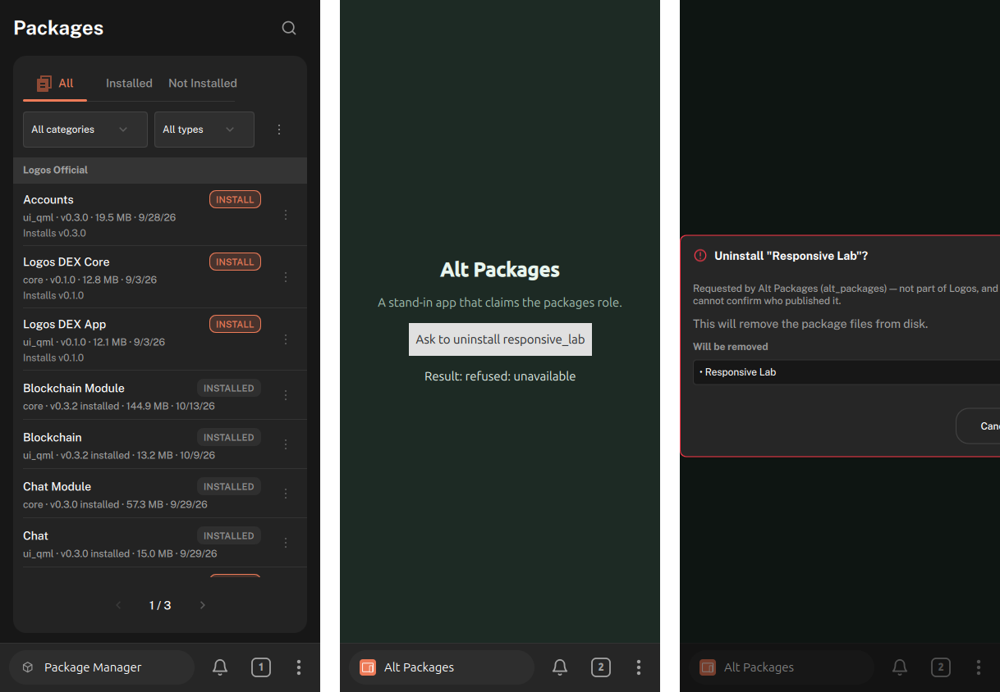
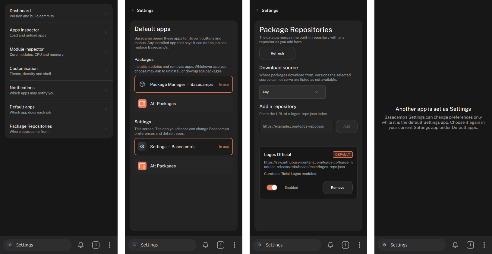
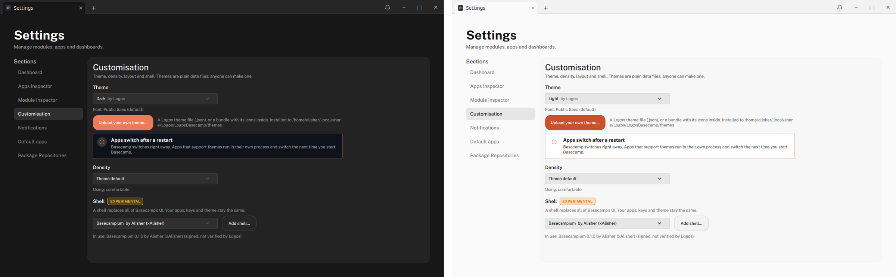
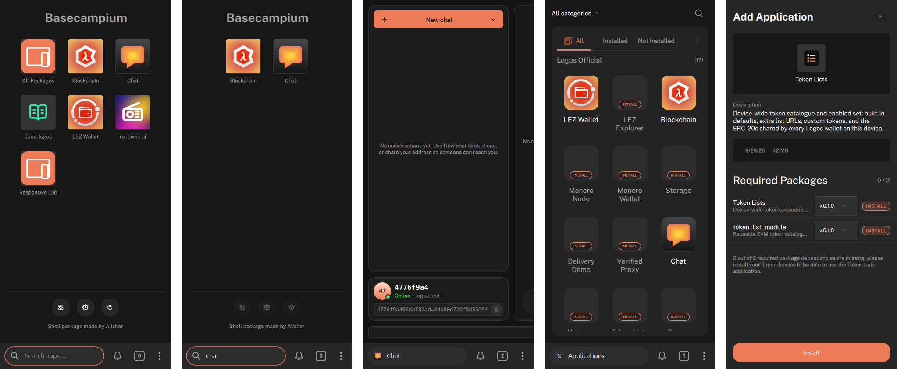
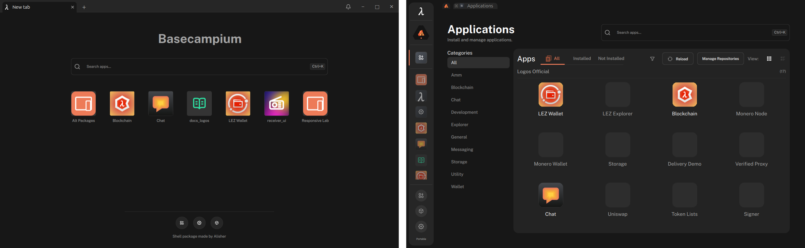

# System apps as roles: Launcher, Packages, Settings

Status: draft, 2026-10-23, branch `shell-roles`. Decision: [ADR-067](adr/0067-system-apps-are-roles.md); steps [068](adr/0068-package-manager-fills-the-packages-role.md), [069](adr/0069-role-apps-get-a-role-gated-shell-object.md), [070](adr/0070-applications-and-new-tab-are-apps.md), [071](adr/0071-role-apps-show-local-icons-only.md).
Based on logos-basecamp `master` (intents as in `docs/app-to-app-intents.md`) plus the Basecampium
branches (`mobile-ironfox`). **All three steps are built** (§9 Package Manager, §10 Settings, §11 Applications and New tab); Part B is not.

## TL;DR

- Applications, Package Manager and Settings stop being part of the shell. Each becomes an
  ordinary `ui_qml` app that **fills a role**: `launcher`, `packages`, `settings`, plus `home`
  (what New tab shows).
- A role is **a slot the user assigns**, not a module type. Basecamp ships a default for each;
  any app whose manifest says it can fill a role can replace it.
- Filling a role **grants a few restricted shell intents** (list installed apps, change shell
  preferences, uninstall). Nothing else gets them. This replaces today's allow-list keyed on a
  self-declared name (`package_manager_ui`) with a choice the user made.
- The shell keeps the frame and the data: bar, tabs, windows, notifications, the list of
  installed apps, preferences. If a role's app is missing or crashes, the shell shows a minimal
  built-in fallback, so a broken launcher or package manager can't lock anyone out.
- Order: Package Manager (already a module) → Settings → Launcher and home. Each step exposes one
  piece of shell API; together they are the first draft of the API in Part B.
- **Part B (direction, after A):** apps publish objects to the shell (notifications, settings
  entries, items), and one search, itself a swappable `search` role, looks across everything apps
  chose to expose.

## 1. Why

- The shell's own apps get privileges no other app can have: a search result for a setting, a
  launcher grid, an uninstall button all reach into shell internals. A third-party launcher or a
  better package manager can't be built, and the APIs these apps need are never written down.
- A shell API that apps can publish into (Part B) only works if the system apps use it too. If they
  stay built in, their results are special cases and the API never gets tested by its first users.
- Shells are already replaceable (`IShellHost`, [SHELL-PACKAGES-SPEC.md](SHELL-PACKAGES-SPEC.md)).
  Roles do the same one level down: replace one part without writing a whole shell.

## 2. Today

| | Where it lives | How it reaches the shell |
|---|---|---|
| **Applications** | shell QML, `src/Basecamp/AppManager/` (grid, list, catalog, add-app dialog) | the host `backend` object: `appsModel`, `launcherApps`, `openApp`, `uninstallApp`, `requestCatalog`, `refreshAppCatalog`; opened as `sys:applications` |
| **Settings** | shell QML, `src/Basecamp/Settings/` (Appearance, Notifications, Repositories, Dashboard, Module / Apps inspector, Plugin interface) | `shellPrefs` (layout, wallpaper, shell, `restart()`), `backend` (`notificationApps`, `setNotificationsEnabled`, `repositories`, `getCoreModuleMethods`, `callCoreModuleMethod`, `load/unloadCoreModule`); opened as `sys:settings` |
| **Package Manager** | its own module `package_manager_ui` (`ui_qml`, depends on `package_manager`, `package_downloader`) | its own core modules, plus intents; but the shell special-cases it: a fixed stack slot (`MainContainer.cpp:46`), preloading (`:580`), the `sys:packages` route, and a placeholder page while it loads |

Upstream already has most of the mechanism this needs (`docs/app-to-app-intents.md`):

- `basecamp.apps.launch`, `basecamp.apps.open`, `basecamp.settings.open`,
  `basecamp.repositories.manage` are serviced by the shell. Any app can ask to launch another.
- **Restricted intents:** `basecamp.packages.confirm_uninstall` / `confirm_upgrade` are limited to
  `package_manager_ui` by a code-declared allow-list (`IntentRegistry::restrictIntentToRequesters`).
  The doc names the weakness: a self-declared name is only as strong as the name.
- **No app can learn what is installed.** Launch answers `ok` whether or not the app exists, on a
  timing floor, precisely so it can't be used to enumerate the user's apps. A launcher needs exactly
  that list, which is why it can't be an ordinary app today.

## 3. Roles

| Role | Fills | Default app | Opened from |
|---|---|---|---|
| `home` | what New tab shows | `basecamp_home` (today's `NewTabPage.qml`) | + / New tab, the bar's pill |
| `launcher` | browse, open, uninstall installed apps | `basecamp_apps` (today's AppManager) | ⋮ → Applications, `basecamp.apps.open` |
| `packages` | catalogs, install, upgrade, repositories | `package_manager_ui` (as is) | ⋮ → Packages, `packages.show` |
| `settings` | shell preferences, per-app switches, developer inspector | `basecamp_settings` (today's Settings) | ⋮ → Settings, `basecamp.settings.open` |

- **Declared in the manifest:** `"roles": ["launcher"]`. A declaration is a claim, not a grant.
- **Assigned by the user:** Settings → Default apps lists each role, the apps that declare it, and
  the current one. Installing an app that declares a role never takes the role by itself; the shell
  asks ("Use Foo as your launcher?") once, from a shell-drawn dialog.
- **Stored by the shell** (shell preferences, per profile). The bundled defaults are assigned on
  first run.
- **One app can fill several roles** (a combined home + launcher is the obvious case).
- **The shell opens roles, not apps.** Its own buttons (⋮ sheet tiles, New tab) and its own
  intents (`basecamp.apps.open`, `basecamp.settings.open`) resolve to whichever app holds the role.
  `sys:applications`, `sys:settings` and `sys:packages` go away.

## 4. What a role grants

Each role unlocks restricted shell intents. Restriction is checked against the **current role
holder**, not a name, so the user's assignment is the grant. Everyone else gets `unavailable` on the
same timing floor as "nothing provides it" (unchanged upstream behaviour).

| Intent (new unless noted) | Kind | Granted to |
|---|---|---|
| `basecamp.apps.list` → `[{ app, displayName, version, category, icon }]` | read | `launcher`, `home` |
| `basecamp.apps.watch` (the list again whenever it changes) | read, subscription | `launcher`, `home` |
| `basecamp.apps.launch` (exists) | navigation | everyone, unchanged |
| `basecamp.packages.confirm_uninstall`, `confirm_upgrade` (exist) | dialog | `packages`, and `launcher` for uninstall (it has an Uninstall item today) |
| `basecamp.prefs.get` / `basecamp.prefs.set` `{ key, value }` (layout, wallpaper, shell, bar position…) | read / mutate | `settings` |
| `basecamp.notifications.apps` / `set_enabled` | read / mutate | `settings` |
| `basecamp.roles.list` / `assign` | read / mutate | `settings` |
| `basecamp.restart` | action | `settings` |

Rules carried over from the intents design:

- **Mutating intents are never in the shell's no-consent navigation group.** `prefs.set` is
  allowed without a dialog only because the requester holds `settings` and the user is looking at
  it; everything destructive (uninstall, upgrade) keeps its confirmation dialog.
- **Plain data only.** Icons can't cross as images or as file paths into another app's
  directory. The shell serves them by name (an image provider such as
  `image://basecamp/app-icon/<app>`, unverified that sandboxed apps can read one).
- **Package Manager's core modules stay direct.** It already talks to `package_manager` and
  `package_downloader` through `logos.module()`; roles don't change that.

## 5. Fallback

A role holder can be uninstalled, fail to load, or crash. The shell must never leave someone without
a way back:

- Missing or failing role app → the shell shows a **minimal built-in page** for that role: for
  `launcher` and `home` a plain list of installed apps that opens them; for `packages` a single
  "Reinstall Package Manager" action; for `settings` the Default apps list and a reset.
- The bundled defaults can't be uninstalled while they hold a role; the Uninstall item is left out
  (ADR-066's "leave out what doesn't apply").
- A crash reports through the notification Basecamp already posts for crashed apps
  ([NOTIFICATIONS-SPEC.md](NOTIFICATIONS-SPEC.md)), with Reopen, plus "Use the default" for a role app.

## 6. Layouts

- **Compact (one bar):** nothing visible changes. The ⋮ sheet's three tiles and New tab open the
  role holders. They become normal tabs (counted and listed), which they already are.
- **Desktop / window layouts:** today the three share one Applications window with a sidebar
  (Applications · Packages · Settings). After the split they are three apps, so three tabs or windows. The sidebar
  can stay as a shell element that opens roles, so the desktop looks the same; it just stops
  containing them.

## 7. Plan

Each step is verified headlessly (390 and 1280, `headless-basecamp-ui`) and gets an ADR.

1. **Package Manager.** Remove the special cases (fixed slot, preload, placeholder,
   `sys:packages`); open it as a normal app through the `packages` role. Restrict
   `confirm_uninstall` / `confirm_upgrade` by role instead of name. Smallest step; proves role
   assignment, opening by role, and the fallback.
2. **Settings.** Move `src/Basecamp/Settings` into a `basecamp_settings` app. Add `prefs.*`,
   `notifications.apps/set_enabled`, `roles.*`, `restart`. Developer views (module inspector, plugin
   interface) call core modules directly, as any app can. Adds the Default apps page.
3. **Launcher and home.** Move AppManager into `basecamp_apps` and `NewTabPage.qml` into
   `basecamp_home`. Add `apps.list` / `apps.watch` and the icon provider.

## 8. Open questions

- **Subscriptions.** Intents are one request, one answer. `apps.watch` needs either a repeated
  answer (a new intent kind) or a shell event an app can listen for. Which fits the frozen runtime
  (`logos-view-module-runtime`) better?
- **Load time.** Settings and Applications are instant today because they're in the shell. As
  separate processes they start like any app. Preload the role holders, or accept the delay?
- **Trust.** A role grant is the user's choice, but the app making the claim is still unsigned.
  Should roles that can uninstall (`launcher`, `packages`) wait for signatures, or ship behind a
  developer flag until then?
- **Upstream.** This touches the core team's shell. It stays an experiment in this repo until it's
  discussed with them; prior art checked: logos-basecamp issues (none on roles or system apps),
  `docs/app-to-app-intents.md`, logos-basecamp#150 (third-party modules can't call other modules,
  relevant if a launcher wants more than the shell's intents).

## 9. Step 1: built

Package Manager is an ordinary app filling the `packages` role. Code in `basecamp/` (mirrors bc-v2
branch `shell-roles`); test app in `experiments/roles-test-app/` ("Alt Packages", claims the role).

- **Host:** `IntentRegistry` reads `"roles"` from each app's `metadata.json` (closed set; unknown
  roles are reported) and can restrict an intent to a role's current holder, failing closed.
  `ShellRoles` keeps the user's assignments (QSettings `[ShellRoles]`) over bundled defaults
  (`packages` → `package_manager_ui`). The backend exposes `roles`, `roleHolder`, `roleCandidates`,
  `assignRole`, `resetRole`, `openRole`.
- **Grant moved from name to role:** `confirm_uninstall` / `confirm_upgrade` go to whoever holds
  `packages`.
- **Shell:** no layout hoists `package_manager_ui` into a fixed slot any more. Every way in (⋮ sheet,
  New tab, sidebar, search, restored tabs, `basecamp.apps.launch`) opens the role holder as an
  ordinary app; a shell page explains when nothing can fill the role.
- **Verified** (headless, 390 / 1280, Basecampium and the built-in sidebar shell; 0 QML errors):
  Package Manager opens as a normal tab, counted; Alt Packages, not holding the role, asks for
  `confirm_uninstall` and gets `unavailable`; after `assignRole("packages", "alt_packages")` the
  same request reaches the shell's confirmation dialog ("Requested by Alt Packages") and cancelling
  answers `cancelled`; Packages then opens Alt Packages; `resetRole` returns it to Package Manager.
  Unit tests: `shell_roles_test` (8 cases) and the existing suite pass.

**Found along the way**
- Package Manager now shows in the app grid and the sidebar like any app, next to the shell's own
  Packages button: two ways to the same place. Decide in step 3 (launcher) whether role apps stay in
  the grid.
- The uninstall confirmation dialog overflows at 390 (its buttons are off-screen). Not new, but now
  reachable from more apps.
- **Not verified live:** the fallback page. Package Manager is embedded in the AppImage, so it can't
  be uninstalled to trigger it; the "nothing holds the role" logic is unit-tested.
- Still name-based: `UIPluginManager` connects to `package_manager_ui`'s install-failure signal by
  name. Harmless, but it should become role- or intent-based.
- Pre-existing: `workspace_area_test` doesn't build in the unit-test harness (it includes a
  design-system header the harness lacks, since the theming commits).
- **No UI yet to assign roles** (Settings → Default apps is step 2); today it's `backend.assignRole`
  or `[ShellRoles] packages=<app>` in `LogosBasecamp.conf`.

## 10. Step 2: built

Settings is an ordinary app, `basecamp_settings` (bundled, QML-only, `apps/basecamp_settings/` in
the Basecamp tree), filling the `settings` role. The shell no longer contains any Settings code.

**Design change from §4.** The draft planned one restricted intent per operation. Settings needs
about 25 operations and two **live** models (the inspectors), and intents are one request, one
answer. Instead:

- **A role-gated object, `shell` (`SettingsApi`),** is injected into the QML engine of the app
  holding `settings`, and of no other app, next to `logos`. It is a narrow, named surface:
  repositories, the inspectors' models and load/unload, notification switches, build info, Default
  apps, and the shell's preferences. It is not the host's `backend`, which can install and
  uninstall without asking.
- **Checked on every read and call,** not only at injection. Give the role away and the object
  goes inert at once; Basecamp's Settings then shows "Another app is set as Settings" instead of
  half-working, and comes back the moment the role returns.
- **The shell's preferences** (layout, shell, wallpaper, restart, file picker) live in the shell
  plugin. The shell hands them to the host (`IShellHost::setShellPreferences`, ABI 3 → 4), which
  passes them to the settings holder only.
- **Icons:** the sandbox blocks reading other apps' files, so the host serves `image://basecamp/…`
  (other apps' icons, wallpaper previews) to the settings holder's engine, and the sandbox lets
  `image://` through only for providers the host registered on that engine (unit-tested). This
  answers §4's "icon provider" question.
- This also answers §8 "Subscriptions" for role apps: a role-gated object carries live models and
  signals; intents stay for one-shot asks from any app.
- Packaging: `apps/*` are copied into the bundle's `plugins/` like Package Manager.

**Default apps** is a new Settings section: each role, the apps that can fill it (Basecamp's marked),
the one in use; a tap reassigns.

**Verified** (headless; Basecampium at 390 and 1280, the built-in sidebar shell at 1280; 0 QML
errors): Settings opens as an app tab from ⋮ / the sidebar; every section works with live data
(Dashboard, inspectors, Customisation, Notifications, Default apps, Repositories); "Manage
repositories" from elsewhere opens Settings on Repositories, including a cold start; choosing
Alt Packages as Settings in Default apps moves the shell's Settings entry to it and Basecamp's
Settings explains it lost the role; resetting restores it live; a theme picked inside the Settings
app switches the whole window (the design system's theme state is process-wide). Unit tests: 31/31
(plus the old `workspace_area_test`, still excluded).

**Open**
- **Density** is stored per QML engine: changing it in Settings changes Settings, not the shell,
  until restart. Themes don't have this problem.
- **Load time:** Settings now starts like any app (a fresh engine) instead of being instant. Not
  noticeable headless; worth a look on real hardware.
- `tests/ui-tests.mjs` (the integration suite) drives the old in-shell Settings; not updated or run.
- Basecamp's Settings imports the shell's `Basecamp.Backend` / `Basecamp.Common` QML types
  (registered process-wide by the shell). Fine for the bundled app; a third-party Settings would
  need those as public API or its own copies.
- The developer inspectors (load/unload any module, call any core method) ride on the same role.
  Splitting them into a separate developer app with its own role is a candidate.

## 11. Step 3: built

Applications is `basecamp_apps` (the `launcher` role) and the New tab page is `basecamp_home` (the
`home` role), both bundled QML-only apps in `apps/`. All four roles now have an app; the shell keeps
the frame, the confirmation dialogs and a fallback page per role.

- **One role object for every role app.** Step 2's `SettingsApi` became `ShellApi`, still injected
  as `shell`, with each member gated by its own role (settings, launcher, home). It is now injected
  into every app that *claims* a role too, so assigning a role later works without reloading the
  app; claiming alone still grants nothing.
- **Launcher:** the catalog model, open / install / uninstall, repositories, and a search hand-off
  (`requestLauncherSearch`, used by the shell's search and the welcome page). Installing and
  uninstalling still open the shell's own dialogs.
- **Home:** Basecampium loads the home app at start and hosts its view inside every New tab instead
  of opening it as a tab. The one bar's text reaches it through `shell.homeQuery`, Enter through
  `homeQueryAccepted`; `shell.launch(name)` and `shell.openRole(role)` turn the New tab into that app.
  Apps holding a role are left out of its grid: they're in the row of shell apps already (this
  closes the duplicate noted in §9).
- **Icons:** installed apps' icons are served by name (`image://basecamp/appicon/<name>`), local
  files only. Apps that aren't installed show a placeholder, **unlike the in-shell Applications**,
  which loaded their catalog icons straight from GitHub (see "Catalog icons bypass the storage
  network" below). The shared app tile (`AppGridDelegate`) takes an `iconOverride`.
- **Shared, not moved:** the app tile, its context menu and the install dialog's pieces stay in the
  shell (its welcome page and dialogs use them); the apps import them like the design system.
- The shell's `ContentViews` is now only its navigation-intent handler; `basecamp.apps.open` /
  `settings.open` / `packages.open` open the roles.

**Verified** (headless; Basecampium at 390 and 1280, the sidebar shell at 1280; no QML errors):
New tab shows the home app with served icons; typing in the bar filters it; Enter opens the first
result; a tile turns the New tab into that app (count 0 → 1 → 2, no stray New tab); ⋮ → Applications
opens the launcher app with the catalog; a search handed from the shell lands in it; tapping an
uninstalled app opens the shell's Add Application dialog (nothing was installed); in the sidebar
shell, Applications opens as an app tab.

**Catalog icons bypass the storage network (upstream, found here).** Each version in the catalog
index carries `"icon": {"path": "<sha256>.png", "sha256", "size"}` beside its manifest.
`logos-package-downloader` resolves the path against the index URL
([package_downloader_lib.cpp#L1351-L1353](https://github.com/logos-co/logos-package-downloader/blob/010059417a3d70cbba508205071343f6eb118d1c/src/package_downloader_lib.cpp#L1351-L1353)),
so the icon becomes a `https://github.com/logos-co/logos-modules-release/releases/download/index/…`
URL, and Basecamp's Applications loads it directly in a QML `Image`. Packages, by contrast, list
storage-network sources first (`logos:logos.dev:<cid>`, then HTTPS). So browsing the catalog sends
one request per icon to GitHub (IP and "browsing the Logos catalog"), and the `sha256` is not
checked on that path. Basecamp no longer does it anywhere: the catalog model keeps `file:` icons only, so Applications, the welcome page's search and Add Application show letters for apps that aren't installed ([ADR-071](adr/0071-role-apps-show-local-icons-only.md)). A fix belongs upstream: icons with storage
sources like packages, fetched storage-first, verified against `sha256`, and cached.

**Open**
- **Home is Basecampium-only.** The sidebar and desktop layouts have their own welcome page /
  desktop, so `home` does nothing there yet, and Basecamp's Home app shows up in their app list.
- The home app counts as a loaded app to the host (it is in the running list), though it is never
  a tab.
- Role apps' own pages (Settings, Applications, Home) currently also show in the sidebar shell's app
  list. A "system app" flag in the manifest could hide them where the shell already has buttons.
- Not tried: assigning `launcher` / `home` to another app (same mechanism as `settings`, verified in
  step 2); uninstall from Applications (opens the shell's confirmation, step 1's dialog).

---

# Part B (direction): apps publish, the shell searches

Not for building yet; Part A comes first, and its intents are the start of this API.

## B1. Model

- **Apps publish objects to the shell:** notifications, settings entries, items (a station, a
  message, a transaction), actions. An app publishes only what it wants the shell to see; its own
  search inside its UI is untouched and private.
- One object shape, extending the notification model in [NOTIFICATIONS-SPEC.md](NOTIFICATIONS-SPEC.md):
  `app` and `icon` set by the shell; `kind` (`notification` · `setting` · `item` · `action`);
  `title`, `subtitle`, `keywords`; `time`; `tag` (same app + tag replaces); and `open`, an intent the
  shell raises back to the app when the user picks the object.
- `basecamp.objects.publish` / `retract`. `basecamp.notifications.post` becomes publishing a
  `notification` object.
- The shell publishes its own: open tabs, recently closed tabs, the installed apps (for the search
  role only).

## B2. One search, many views

- **The bar is a search field in every view.** The view only sets the default filter: "Search
  apps" on home, "Search tabs" in the switcher, "Search settings" in Settings. Nothing is taken
  away to show a title.
- **Filters are pills** (Apps · Tabs · Settings · Feed · per app). Saved filters become pills of
  their own in a scrollable row.
- **The feed** is the same objects sorted by time; notifications are the feed filtered to
  `notification`.
- **Launcher, tab switcher, history and feed are views** over the same data; a role app chooses how
  to draw them.
- **`search` is a role** like the others: it gets `basecamp.objects.query`, and replacing it
  replaces how everything is found and ranked.

## B3. Privacy

- Nothing is indexed unless an app publishes it; objects stay on the device.
- Settings → Search lists each app that publishes, with a switch (as Notifications does).
- Only the `search` role can query across apps; an ordinary app sees only its own objects.
- Open: limits (size, count, rate), how long objects live, and whether a published object may carry
  anything private (message text) or only a pointer the app resolves when opened.
