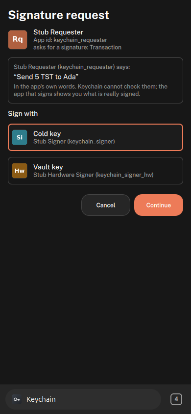
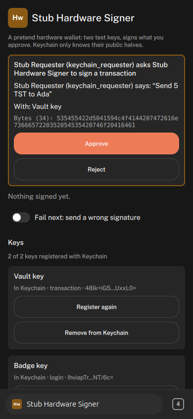
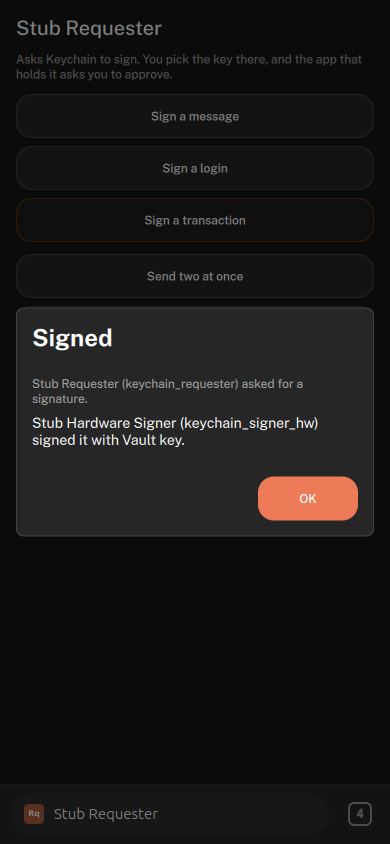

# Keychain stubs

Three QML-only `ui_qml` apps for testing Keychain (issue #59, epic #62): two signers that hold
keys and a requester that asks for signatures. They drive every path in #58's test list, and with
two signers a transaction or a login offers keys from two apps, so the user really chooses. Keychain
itself is the `keychain` role app in Basecamp (`apps/basecamp_keychain`, branch `keychain`).

| App | Display name | Uses | Provides |
|---|---|---|---|
| `keychain_signer` | Stub Signer | `basecamp.appdata.read`, `.write`, `basecamp.keychain.register`, `.update`, `.remove`, `.keys`, `.complete`, `.reject` | `keychain.sign`, `keychain.ended` |
| `keychain_signer_hw` | Stub Hardware Signer | the same as Stub Signer | the same as Stub Signer |
| `keychain_requester` | Stub Requester | `basecamp.keychain.sign`, `.cancel` | none |

Every answer from the shell has `ok: true`; the real outcome is in `data` (`data.ok`,
`data.error`), because the intent broker rewrites error codes it does not know.

## Stub Signer and Stub Hardware Signer

Both signers are the same code (`common/SignerApp.qml`, see "Shared code" below); each app's
`Main.qml` gives only its name, its two keys, the letters and colour of its badge:

| App | Keys | Badge |
|---|---|---|
| Stub Signer (`keychain_signer`) | "Daily key" (`message`, `login`), "Cold key" (`transaction`) | "Si", teal |
| Stub Hardware Signer (`keychain_signer_hw`, a pretend hardware wallet) | "Vault key" (`transaction`), "Badge key" (`login`) | "Hw", amber |

The badge sits next to the app's name on its screen and colours the border of the request on
screen, so it is plain which signer Keychain opened. Below, "the app" is either of them.

- **First start** makes the app's two Ed25519 key pairs and keeps them in the data the host
  holds for this app alone: `basecamp.appdata.read` / `.write` (Basecamp `app/AppDataStore.h`),
  one JSON object per app in `<profile>/app_data/<app id>/appdata.json`, owner-only file mode,
  keyed by the caller the host attested, so no other app (the other signer included) can ask for
  it. Not QML LocalStorage: every `ui_qml` view runs in the host process, and Qt hands an already
  open database connection to any engine that asks for the same database name (Basecamp
  `tests/sandbox/tst_qml_sandbox.cpp`, `localStorageInTheAppsFolder`), so any app could have read
  the seeds by opening the signer's database name. Uninstalling the app removes its data. Keys
  are registered only once they are kept. On every start it registers both public keys; a
  `duplicate` answer is followed by an `update` (name, purposes).
- **Sign screen.** The shell sends `keychain.sign` `{ requestId, keyId, payload, kind, purpose,
  requesterApp, requesterName, description }`. The app answers `ok` as soon as the request is on
  screen, then shows who asks (name and the attested app id) and its own name, their description
  in quotes as their words, the kind, the key, and the payload in hex (first 64 bytes). **Approve** signs and calls `complete { requestId, signature }`;
  **Reject** calls `reject { requestId, reason }`. A request for a key the app no longer has is
  rejected at once. `keychain.ended { requestId, status }` takes the request off the screen and
  shows "Request ended: <status>". Both intents are accepted from the shell (`main_ui`) only.
- **Fail next** makes the next approval send the signature with one bit flipped, so the request
  ends as `failed` (the shell checks every signature against the registered key).
- **Keys** lists both, whether Keychain has them (from `basecamp.keychain.keys`, matched by key id
  and public key), their purposes and a short public key, with **Register again** and **Remove
  from Keychain** (the app keeps the private key; Register again brings it back).

objectNames, prefixed with the app id (`keychain_signer.` or `keychain_signer_hw.`): `.root`,
`.header`, `.title`, `.request`, `.request.title`, `.request.description`,
`.request.key`, `.request.payload`, `.approve`, `.reject`, `.idle`, `.ended`, `.lastAnswer`,
`.failNext`, `.status`, `.key.<keyId>`, `.key.<keyId>.state`, `.key.<keyId>.register`,
`.key.<keyId>.remove`, `.registerAll`.

## Choosing a key

With both signers installed and started once (each registers its keys on start):

1. In Stub Requester, **Sign a transaction**. Keychain's request sheet offers **Cold key** (Stub
   Signer) and **Vault key** (Stub Hardware Signer), each with its app's badge and app id.
2. Pick **Vault key** and **Continue**. Keychain opens **Stub Hardware Signer** (amber "Hw"
   badge), which shows "Stub Requester (keychain_requester) asks Stub Hardware Signer to sign a
   transaction" and "With: Vault key".
3. **Approve**. The shell's Signed sheet over the requester says "Stub Hardware Signer
   (keychain_signer_hw) signed it with Vault key", and the requester's last result shows
   `Vault key (vault) of keychain_signer_hw`, "Verifies here: yes".
4. Again with **Cold key**: Stub Signer (teal "Si") opens instead. **Sign a login** offers
   **Daily key** (Stub Signer) and **Badge key** (Stub Hardware Signer). A message has only
   Daily key to offer.

Keychain preselects the key used last, so pick the key explicitly when a test depends on it
(`basecampKeychain.request.key.<app id>.<keyId>`).

  

## Stub Requester

- **Sign a message / a login / a transaction**: each sends a fixed payload (UTF-8 text starting
  `STUB-PAYLOAD`, so a test can grep a run log for it) and a fixed description ("Sign a note for
  Ada", "Sign in to Weekend hike", "Send 5 TST to Ada").
- The answer to `basecamp.keychain.sign` arrives when the request ends: `data` is `{ requestId,
  status, signature?, publicKey?, keyId?, keyName?, signerApp?, error? }`, or at once `{ error:
  busy | bad_request | unavailable | not_in_front }` (shown as "refused"). Only the app in front
  may ask, and an app is held off (`busy`) for 10 seconds after a request it or the user
  cancelled or that timed out, and after 5 requests in a minute.
- **Last result**: status (and error), key name and id, signer app, a short signature, and
  whether the signature verifies here against the public key in the answer.
- **Send two at once** asks for a login and a message together; the second answer is `busy`
  (one open request per app).
- **Cancel my request** cancels the open one.

objectNames: `keychain_requester.root`, `.message`, `.login`, `.transaction`, `.two`, `.cancel`,
`.result`, `.result.status`, `.result.key`, `.result.signature`, `.result.verified`, `.second`.

Neither app logs a payload, a description or a private key: only request ids, states and key ids.

## Ed25519: TweetNaCl-js, vendored

`common/nacl-fast.js` is TweetNaCl-js **1.0.3** (public domain, `common/nacl-fast.LICENSE`),
byte for byte, from the npm tarball fetched through nix:

```
nix store prefetch-file https://registry.npmjs.org/tweetnacl/-/tweetnacl-1.0.3.tgz
  tarball sha256 (SRI)  sha256-X43EnLRIPiBro+uyKrvM/AIYxZtg/HjM4kGXztW54QI=
  tarball sha512 (SRI)  sha512-6rt+RN7aOi1nGMyC4Xa5DdYiukl2UWCbcJft7YhxReBGQD7OAM8Pbxw6YMo4r2diNEA8FEmu32YOn9rhaiE5yw==
                        (= the registry's dist.integrity for tweetnacl@1.0.3)
  package/nacl-fast.js  sha256 6bcd37a3b20dce913f82d4b23e4e2b661058b4b953df8a3f8c45d56ac4f72447
```

`common/KeychainCrypto.js` wraps it: base64, UTF-8, `newSeed`, `publicKey(seed)`,
`sign(seed, payload)`, `verify(publicKey, payload, signature)`, `spoil(signature)`. It uses no
`Qt` object, so it also runs in a bare QJSEngine. **Test code**: QML has no
`crypto.getRandomValues`, so `newSeed` mixes `Math.random` and the clock through SHA-512, and the
seeds are stored unencrypted. A real signer takes its randomness from the OS and protects its keys.

**Interop with the shell.** Basecamp's `tests/keychain_stub_crypto_test.cpp` loads a copy of
`SignerCrypto.js` (`tests/fixtures/keychain/SignerCrypto.js`) and checks it against the host's
OpenSSL EVP Ed25519 (`app/KeychainVerify.cpp`): RFC 8032 §7.1 TEST 1 and TEST 2 (same public
keys, same signatures, OpenSSL verifies them), a key from `newSeed` over a UTF-8 payload, the
`spoil`ed signature failing, and the stub's keys through the broker (`done`, then `failed`).

## Shared code and sync.sh

`sync.sh` writes each app's `<Prefix>Crypto.js` (`SignerCrypto.js`, `HwSignerCrypto.js`,
`RequesterCrypto.js`): `common/KeychainCrypto.js` with `common/nacl-fast.js` in place of its
marker line. For the two signers it also writes the shared signer, `common/SignerApp.qml`, as
`StubSignerApp.qml` and `HwSignerApp.qml`, each importing its own app's crypto file. Copies,
because the plugin sandbox keeps each app inside its own folder; renamed, because two `ui_qml`
apps shipping a file of the same name collide in the host (see `../objects-stubs/README.md`).

```
./sync.sh                         write the copies (refuses a nacl-fast.js with another sha256)
./sync.sh --check [<bc-apps>]     exit 1 on drift; with a Basecamp checkout, also its test fixture
./sync.sh --install <profile>     sync, then copy all three apps into <profile>/plugins/
```

Never install into `/extra/tmp/mmorpg/roles-profile`: copy it first. Open an app headless with
`backend.loadUiModule("keychain_requester")`.

## Icons

`gen-icons.py` (the objects stubs' generator, three entries) draws each `icon.png`: a full-bleed
256x256 square with the app's letters, no rounding baked in; the shell rounds tiles when it draws
them. `python3 gen-icons.py --check` fails on a transparent corner.
